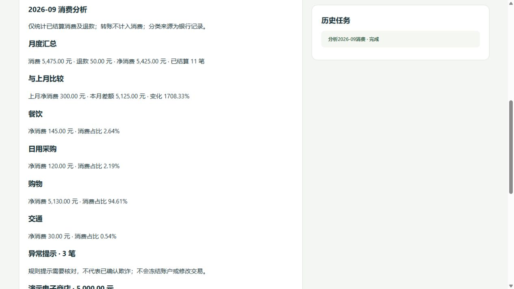
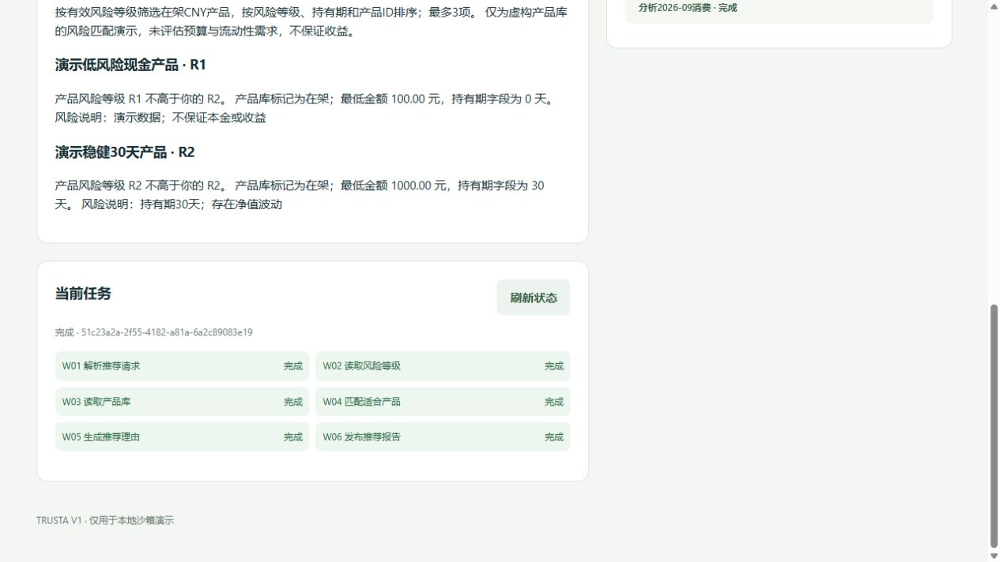
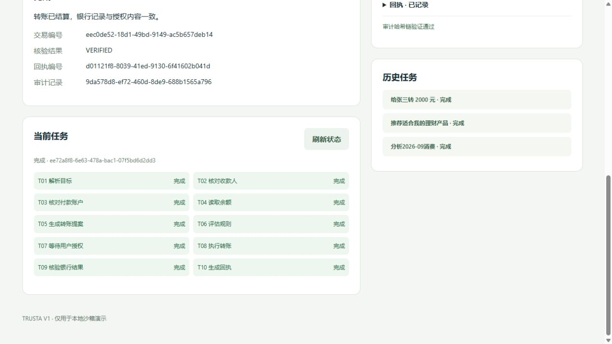

# TRUSTA Phase 2 场景扩展

扩展现有 V1 Core，只激活原注册表中的 Finance、Wealth。Service 保持 inactive。转账 BankActionIR、Schema Validator、Policy、Authorization、Execution Contract、Gateway.execute、Hard Verifier 和账本写入实现不变。

## 新增文件

```text
backend/
├─ business.py                  # 三种任务类型、分析月份、只读DAG模板
├─ agents/
│  ├─ finance.py                # 消费读取、分类/月度统计、规则异常提示
│  └─ wealth.py                 # 风险档案、产品筛选、有依据的推荐理由
├─ runtime/
│  └─ scenarios.py              # 确定性只读场景调度、Blackboard结果、审计
└─ banking/
   └─ scenario_seed.py          # 虚构历史消费、风险档案、产品样例
scripts/
└─ scenario_demo.py             # 三个实际HTTP场景
tests/
└─ test_scenarios.py            # 只读、隔离、分析正确性及兼容性
docs/
├─ phase2-scenarios.md
└─ phase2-demo.json             # 实际演示输出
```

扩展文件：Blackboard、Planner、Intent、Agent registry、Capability grants、Adapter manifest、Gateway.read、持久化 schema、Service 只读任务路由、前端结果呈现。没有新建其他 Agent，没有新增资金写能力或资金写端点。

## 任务与数据流

三种 task_type：`TRANSFER`、`BILL_ANALYSIS`、`WEALTH_RECOMMENDATION`。Blackboard 新增通用 `result`，保留全部 V1 字段。原 transfer DAG 保持 T01–T10；两种只读 DAG 各6步。Planner 提供 DAG，Runtime 按相应固定模板验证，Scheduler 控制合法状态迁移。

共同入口：HTTP → Intent Normalization（非Agent）→ Supervisor → Planner → 任务DAG。关键交接沿用 Agent identity、signature、payload hash、持久化 nonce。结果保存 Blackboard 并追加审计哈希链。

### Finance

```text
结构化月份 → Finance
  → Tool Gateway（account.read / transaction.read）
  → Bank Adapter → 客户所属账户 / 历史消费记录
  → Blackboard读取快照
  → 分类统计 → 月度比较 → 异常规则提示
  → 签名报告 → Blackboard.result → Audit
```

Gateway 新增规范只读能力 `transaction.list`，账户归属检查后读取客户范围内的消费记录；月份按 Asia/Shanghai 的自然月半开区间过滤。统计对象为已结算 PURCHASE/REFUND，转账不计入消费，未结算记录不计入金额。金额保持整数分。

类别取银行记录中的分类代码，未知代码归入“未分类”。展示消费总额、退款、净消费、分类消费占比，以及与前一月的净消费比较。上一月净消费非正值时不给出变化百分比，避免无意义或除零结果。

异常规则仅提示核对：默认单笔≥1000元、超过本月消费中位数10倍（至少5笔消费）、相同商户/金额/币种在300秒内重复。仅检测选定月份内的已结算消费，不确认欺诈、不冻结账户、不修改交易。金额阈值与时间窗口可在 `.env` 配置。

### Wealth

```text
推荐请求 → Wealth
  → Tool Gateway（risk_profile.read / wealth_product.read）
  → Bank Adapter → 当前客户风险档案 / 全局演示产品库
  → Blackboard读取快照
  → 有效风险等级匹配 → 有来源引用的理由
  → 签名报告 → Blackboard.result → Audit
```

新增规范只读能力 `customer.get_risk_profile` 和 `wealth.list_products`。客户身份由运行时上下文传入，不接受请求覆盖风险等级或指定其他客户风险档案。只筛选在架CNY产品，产品风险等级不得高于有效客户风险等级；按风险、持有期、ID排序，最多3项。显示最低金额与产品风险说明，不读取账户余额、不声称客户已满足预算条件、不生成收益承诺。

风险档案缺失/过期进入 WAITING_USER，无产品匹配时返回空推荐，不降级推荐超风险产品。购买、赎回等请求等待用户改为只读推荐；无相应 capability、执行方法或 API 端点。

## 状态变化边界

只读任务只改变工作流状态与分析产物，由原 Scheduler/Blackboard 和 Audit 持久化。它们不改变客户/账户/交易/账本/风险档案/产品数据，不产生 BankActionIR、policy decision、authorization、execution contract 或金融 execution receipt。

所有金融状态变化仍只通过 V1 Trusted Execution Pipeline：BankActionIR → Schema/Capability → Policy → Authorization → Execution Contract → Tool Gateway → Bank Adapter。分析报告不伪装成金融执行回执。

数据库以 `CREATE TABLE IF NOT EXISTS` 新增 `consumption_records`、`risk_profiles`、`wealth_products`，没有修改已有交易/账本表。历史消费为虚构只读样本，表示独立于当前开户余额的历史记录，不通过这些样本扣款或补造转账。初始化样例不是用户金融写API，已有余额与WAITING_USER转账任务保持原值。

## 三个Demo

```powershell
python -m scripts.scenario_demo --output docs/phase2-demo.json
```

脚本启动真实本地HTTP服务，对隔离SQLite银行依次执行三个场景：

| 输入 | 结果 |
|---|---|
| 给张三转 2000 元 | 用户明确确认后SETTLED、VERIFIED；余额10000→8000元 |
| 分析2026-09消费 | 消费5475元、退款50元、净消费5425元；四类统计、上月比较、3笔异常提示 |
| 推荐适合我的理财产品 | 客户R2，推荐演示R1/R2产品；排除R4及下架产品；提供风险匹配理由 |

两种只读场景前后余额一致，审计链有效，三个完成任务在服务重建后仍存在。也可运行 `start.ps1`，使用页面上的三个示例按钮。

## 限制

延续V1确定性Agent和有限句式，不声称已经接入外部LLM。消费数据与产品均为沙箱虚构记录；推荐仅验证风险匹配规则，不是完整投资适当性评估。未知意图保持等待澄清。没有新建风险评估Agent，也没有新增数据修改或产品购买功能。

## 验证结果（2026-10-05，Asia/Shanghai）

- 全量测试 `python -m unittest discover -s tests -v`：59项通过，含原有38项、19项场景测试、2项新增HTTP接口测试。原V1的20项验收全部保留并通过。
- `node --check frontend/app.js`：通过。
- 三个实际HTTP Demo：全部完成；两类只读任务余额不变，审计链有效，重建服务后任务与报告保留。完整输出见 `phase2-demo.json`。
- 浏览器分别验证消费分析、理财推荐、原转账授权/核验，以及历史任务切换。使用独立 `data/phase2-ui.sqlite3`，未改变默认演示数据库。
- 只读限制同时检查Capability拒绝、真实银行表快照不变、没有金融产物及Agent代码无Adapter/数据库/执行调用。即使持有有效转账合约，Finance/Wealth仍不能执行。




