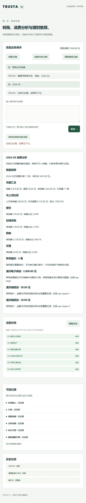

# TRUSTA Phase 3.2：Conversation 与受约束辅助推理

交付日期：2026-10-05。在 Phase 3.1 的 Provider / Gateway / Router 基础上增加多轮会话、来源可校验的意图候选、模板计划校验和业务说明。保留五个 Agent、三个业务场景、原银行 Capability Grants 和 Trusted Execution Architecture。模型默认关闭，未调用真实供应商或使用真实密钥。

本文保留 Phase 3.2 交付记录。当前 [Phase 3.3](phase3.3-memory-communication.md) 的类型化 Memory、消息版本、密钥版本轮换与扩展接口已完成；下文阶段测试数字和后续规划为当时记录。

## 架构变化与数据流

```text
用户 / 浏览器
  → 已认证 Conversation Layer（非 Agent，归属 / revision / turn_id / TTL）
  → 输入控制检查 + Intent Normalization
  → Supervisor 提出意图候选（assisted，必要时）
       → LLM Gateway → Model Router → 配置的 Provider
       ← 封闭 JSON → 来源片段校验 → 会话版本检查 → 单次消费
  → 确定性字段转换 → 结构化任务 → Blackboard
  → Planner 提出模板候选（assisted）
       → 共享 Gateway / Router / Provider
       ← 模板校验 → 运行时生成冻结 DAG → PlanValidator
  → 确定性 Scheduler → Transaction / Finance / Wealth
  → 原金融执行或只读业务路径
  → Finance / Wealth 可选择说明焦点、样式、理由代码
       → 事实与引用校验 → 确定性渲染 → 单独 presentation
```

模型调用是 Agent 的推理依赖，并不是银行执行前的万能串行节点。Conversation 不直接访问 Bank Adapter；Supervisor 不新增身份权限；Scheduler 不接受自由生成步骤。

金融执行继续完整经过：

**BankActionIR → Schema / Capability Check → Policy → Authorization → Execution Contract → Tool Gateway → Bank Adapter → Verification → Audit**。

账单与理财仍只读取银行事实。没有 LLM → Bank API、购买、赎回、自动审批或自动金融写重试。

## 意图、计划与说明的技术决策

| 用途 | 模型可输出 | 确定性检查与最终职责 |
|---|---|---|
| conversation_intent | task_type、收款人 / 金额 / 月份原文片段、是否需澄清 | 独立有限句式解析验证来源；不得新增字段或补造缺失值；运行时转换整数分和月份 |
| plan_proposal | 三个既有场景的模板选择 | 模板与任务类型必须一致；运行时构建完整既有 DAG；PlanValidator 校验任务、步骤、依赖与所有者 |
| finance_presentation | 月度或异常焦点、简短或详细样式、证据别名 | 只允许已存在的统计及异常依据；数值由运行时渲染 |
| wealth_presentation | 已筛选的产品 ID、固定理由代码、样式、证据别名 | 产品集合必须精确一致；风险来自银行；期限与起购额来自产品库；无自由事实断言 |

意图结构为 `{task_type, recipient_text, amount_text, month_text, needs_clarification}`，多余字段拒绝。UNKNOWN 仅是会话中的未确定状态，不新增 Blackboard 业务场景。关键值必须来自当前原文或同一有效会话的已验证槽位，并保存来源 turn 引用。账户归属、收款人解析、余额、风险等级、产品过滤、Policy、Authorization、合约和执行主体均由原系统确定。

支持有限同义句式、准确中文数字与多轮补充；“两千五”“一百一”等歧义简写要求澄清。否定、条件、示例、混合场景先阻断或澄清。无法独立验证的自由表达不生成金融动作。这一阶段未实现任意自然语言理解。

标准完整请求可绕过意图模型；模型不可用时仍可走确定性标准输入。部分请求在 assisted 模式下遇到模型超时、幻觉或无效 JSON 时请求澄清，不把未经校验的结果降级为金融执行。计划失败采用完整固定模板；说明失败保留原有业务报告。

`result` 保留确定性统计与筛选结果；新增 `presentation` 仅供说明展示。模型不能重写净支出、风险画像、产品池、IR、授权或回执。

## 会话、安全与恢复

- 每个会话绑定已认证客户，客户端不能传入 user_id、risk_level、model、endpoint、task_type、intent 或 approve。
- 会话 TTL 为 3600 秒，最多 20 轮，每轮处理期限 120 秒；每轮原文最多 1000 字符。该上下文不是长期 Memory，不参与银行权威事实。
- 相同 turn_id 与原文 / 源账户重复提交返回原结果；不同请求复用 ID 拒绝。revision 防止陈旧与并发写入。同一会话仅允许一个进行中的轮次。
- 调用期间不持有运行时全局锁。提交前复核归属、会话 / 任务版本、期限与状态；关闭会话后的迟到结果不消费。
- 新金融任务在模型计划等待前绑定会话。取消、替换金额或收款人会先撤销旧待审批动作，再构建新 IR、动作哈希和授权卡。原授权不能用于新动作。
- “我确认”等聊天文字只提示核对授权卡；实际授权仍需 `/authorize` 的精确 action_hash。明确拒绝会取消待处理动作，已结算交易不会被撤销。
- 持久化会话、轮次、输入来源、调用引用和审计；刷新与服务重建可恢复。浏览器保留尚未确认结果的 turn_id，未知网络失败后重试同一轮，避免重复创建请求。
- 中断轮次不自动执行或重发模型；期限届满后，下次发送清理该轮并取消关联的未执行草稿。原交易执行不确定仍进入 MANUAL_REVIEW。

增量新增 `conversations`、`conversation_turns`、`conversation_llm_calls`，保留 Phase 3.1 `llm_calls` 的 task 外键及已有记录。调用表 / 审计不存原始提示和模型响应；会话表会保存用户原文，TTL 限制使用期限，**尚无物理删除、保留期限清理或文件加密**。不要输入真实秘密或真实金融客户数据。

推理仍受 Gateway 的用途权限、数据分类、安全级别与 Provider 配置约束。模型与 API 切换只改管理员配置并重启；Agent 不绑定模型标识。扩展原生协议通过 Provider Interface，沿用 Phase 3.1 的 HTTP / OpenAI Compatible 适配器。

## 新目录与修改清单

```text
backend/conversation/
  __init__.py
  schemas.py                # 有限句式、控制检查、字段转换
  store.py                  # 归属、版本、幂等轮次、期限、审计
  service.py                # 多轮协调；调用现有运行时
backend/llm/
  prompts.py                # 用途与封闭输出提示
  explanations.py           # 基于权威结果渲染说明
backend/runtime/
  plan_validator.py         # 冻结 DAG 校验
config/llm.assisted.example.toml
tests/test_conversation.py
tests/test_conversation_api.py
scripts/phase3_conversation_demo.py
docs/phase3.2-conversation.md
docs/phase3.2-demo.json
docs/phase3.2-ui.png
```

修改现有模块：

| 文件 | 修改目的 |
|---|---|
| backend/service.py | 结构化任务入口、锁外辅助计划、待审批取消、只读说明 |
| backend/server.py | 认证会话 API、严格请求字段、所属调用追踪 |
| backend/persistence.py | 增量会话与调用表 |
| backend/runtime/blackboard.py | 安装计划时校验冻结 DAG |
| backend/agents/supervisor.py、planner.py、finance.py、wealth.py | 注入共享推理依赖；保留确定性业务职责 |
| backend/agents/registry.py | 新增推理用途授权，银行权限不变 |
| backend/llm/contracts.py、configuration.py、gateway.py、projection.py | 会话作用域、assisted 模式、来源与说明校验 |
| backend/llm/providers/mock.py | 明确标识的离线会话与说明样例 |
| frontend/index.html、app.js、styles.css | 多轮输入、会话恢复、原授权卡、说明展示 |
| config/llm.example.toml、tests/test_model_router.py | 新用途及模式兼容；默认 disabled |
| README.md、docs/api.md、architecture.md、assumptions.md、validation.md、phase3-model-agnostic-platform.md | 当前阶段、接口、结果及历史说明 |

不引入 SDK、向量库、消息中间件、新 Agent 或银行写端点。

## 配置与运行

默认无需配置，仍支持确定性会话。显式开启离线辅助演示：

```powershell
Copy-Item -LiteralPath config/llm.assisted.example.toml -Destination config/llm.toml
$env:TRUSTA_LLM_CONFIG = (Resolve-Path -LiteralPath config/llm.toml).Path
.\start.ps1
```

示例 Provider 为离线固定样例，不会调用真实 API。真实 Provider 的 endpoint、model、api_key_env、用途路由和数据处理审核由管理员配置，见 [Provider 与 Router](phase3-model-agnostic-platform.md)。修改配置前保留已有本地配置。

## 测试与三个 Demo

2026-10-05：`python -m unittest discover -s tests -v` **118 项全部通过，66.946 秒**；原 92 项保留，新增 20 项会话测试与 6 项实际 HTTP API 测试。新增覆盖：来源补全、金额幻觉、额外执行字段、跨会话与归属、过期 / 并发 / 迟到响应、幂等轮次、计划绕过拒绝、风险与产品捏造、金额 / 收款人替换、聊天确认、明确拒绝、结算后禁止编辑和重启恢复。`node --check frontend/app.js` 与 `python -m compileall -q backend scripts tests` 通过。实际演示见 [验证记录](validation.md)。

```powershell
python -m scripts.phase3_conversation_demo --output docs/phase3.2-demo.json
```

脚本使用独立临时 SQLite Virtual Bank 和实际 HTTP 接口；推理使用离线样例。日常沙箱不被修改。

| 场景 | Demo 流程与结果 |
|---|---|
| TRANSFER | “帮我给张三转账” → 澄清 → “两千元” → 待审批；“我确认”不扣款；“金额改成2500元”撤销旧审批；旧授权拒绝，新授权通过；余额 10000 → 7500 元，一笔交易，COMPLETED / VERIFIED |
| BILL_ANALYSIS | “帮我分析消费” → 澄清月份 → “2026-09”；净支出 5425.00 元，基于 11 条已结算记录生成说明 |
| WEALTH_RECOMMENDATION | “推荐适合我的理财产品”；银行 R2、sandbox-r1 / sandbox-r2、理由来自产品库与风险档案，无购买 / 赎回 |

审计链有效，只读场景不改变余额，三会话与任务重建后保留。实际结果见 [Demo JSON](phase3.2-demo.json)。浏览器进一步验证多轮输入、聊天确认无执行、金额修改新哈希、授权卡执行、VERIFIED 回执、刷新恢复、账单澄清与理财说明。



## 后续与技术风险

下一阶段 Phase 3.3：类型化 Memory（来源 / TTL / 同意 / 删除接口）、Agent Registry 与 Capability Registry 一致性、版本化消息及密钥轮换，并预留默认关闭的 DID / ECDSA / Merkle Audit / Blockchain Anchor / ZKP 接口。

当前会话不是长期用户偏好存储。风险画像始终读取银行权威档案，Memory 未来只能帮助表达与检索，不能覆盖金融事实、授权或执行条件。

尚需真实模型的标注样本评估，才能证明理解率与拒绝率；当前保守来源校验会拒绝部分合法自由表达。配置的成本和延迟仍为估算。Provider 代码与银行运行时尚同进程，生产隔离、认证、密钥托管、数据保留治理及真实银行适配未完成。不能把离线样例或本地协议测试描述为真实模型能力验证。
