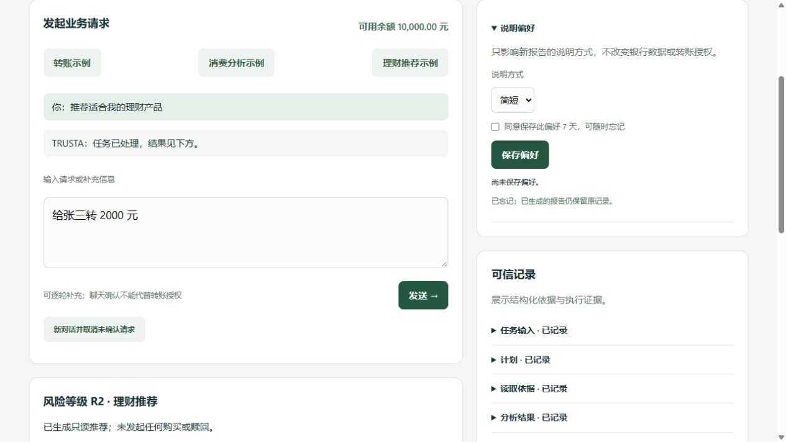

# TRUSTA Phase 3.3：类型化 Memory 与可信通信增强

本文保留 Phase 3.3 历史交付，HMAC V2 与接口占位说明适用于该阶段。当前版本见 [Phase 4](phase4-cryptographic-trust.md)：正常入口默认 ECDSA V3，Merkle / 本地锚定已实现，原 Memory 与金融边界保持。

交付日期：2026-10-06。基于 Phase 3.1 / 3.2 增加明确同意的类型化 Memory、统一身份与权限查询、版本化消息、可轮换的消息密钥版本，以及默认关闭的未来扩展接口。保留 Supervisor、Planner、Transaction、Finance、Wealth 五个 Agent，没有新增 Agent 或金融业务。

## 架构变化与数据流

```text
已认证用户
  → 明确同意保存偏好 / 引用
  → MemoryStore：封闭类型、来源、客户归属、revision、TTL、Audit

Conversation → Intent Normalization → Supervisor → Planner
  → Blackboard / 确定性 Scheduler → 原业务 Agent
  → 原银行读取与确定性统计 / 筛选
  → 可选 Gateway / Router / Provider 说明候选
  → 运行时重新读取有效偏好 → 确定性说明渲染 → presentation

Agent 交接
  → Agent Registry / Capability Registry
  → V2 Envelope：身份、任务、步骤、载荷引用 / hash / revision、算法、key_id、nonce、期限
  → HMAC 校验 → 场景通信方向 / 引用 / 任务版本校验
  → 持久化消费 nonce → Audit → 接受 Agent 结果
```

Memory 不进入模型提示、意图槽位、Planner 模板、BankActionIR 或金融安全决策。Conversation 的本轮已验证来源仍是转账字段的唯一用户输入来源。引用 Memory 不自动恢复或重发以前的转账。

金融写链路完整保留：**BankActionIR → Schema / Capability Check → Policy → Authorization → Execution Contract → Tool Gateway → Bank Adapter → Verification → Audit**。Memory 不生成授权，LLM 无 Bank API 或工具执行权限；Finance / Wealth 无购买、赎回或银行写能力。

## Memory 类型与安全决策

| 类型 | 实际保存 | 用途与边界 |
|---|---|---|
| PREFERENCE | explanation_style：brief / detailed；finance_focus：monthly_summary / anomaly_summary | 只影响后续说明样式或焦点；无异常时不会编造异常 |
| CONVERSATION_REFERENCE | 当前客户有效会话 ID 的引用，value=null | 引用期限不超过原会话；关闭会话后读取会清理引用；不复制原文、不自动带入金融槽位 |
| RISK_REFERENCE | 当前客户银行风险档案引用，value=null | 保存前经过 Wealth 的银行读取与有效性检查；期限不超过档案；不保存风险等级，推荐仍每次重新读取银行 |

每项保存 memory_id、schema_version、revision、source_ref、trust、consent_at / consent_ref、created_at / updated_at、expires_at。更新同一类型与键递增 revision，重新记录同意来源。客户端不能传入任意 kind、source_ref、trust 或身份。

明确同意 `consent=true` 是写入条件；数字 1、字符串或省略均拒绝。默认 7 天，最长 30 天；会话与风险引用还受源对象期限约束。用户可查询、单项忘记、清空所属 Memory。启动及 Memory 访问 / 更新时清理过期记录；没有后台定时清理服务。

禁止保存金额、付款账户、收款人、转账草稿、余额、完整流水、用户自行声称的风险等级、审批状态、执行合约、密钥或自由文本。字段与枚举白名单从输入上限制这些内容。不会从聊天或模型输出自动提取长期 Memory。

Agent Memory 读取能力与银行、推理权限分别管理：Supervisor 可读偏好与会话引用；Finance 仅偏好；Wealth 可读偏好与风险引用；Transaction / Planner 无 Memory 权限。当前实际业务使用仅在 Finance / Wealth 的说明渲染阶段。其余引用读取接口为后续受控检索保留，不执行跨会话金融补全。

推理等待不持有全局锁；推理完成后，在共享运行时锁内重新读取同意与期限，并生成说明。Memory 更新 / 删除使用同一锁，因此单进程内已完成的撤回不会被之后的说明提交忽略。原 `result` 和已验证的模型候选不被偏好覆盖，变化单独记录在 `presentation.memory_refs` 与 Audit。

模型 disabled 时，如有有效偏好，可以确定性渲染说明，source=MEMORY_TEMPLATE；assisted 中有效模型说明候选为 LLM_ASSISTED_TEMPLATE。没有偏好且模型关闭时保留原业务报告。模型不可用也不会把 Memory 变为银行事实。

“忘记”删除的是 `agent_memory` 行，不抹去既有报告、Conversation 原文或审计。审计只保存事件及载荷哈希，Memory 内容不复制进审计正文。SQL 删除不等于磁盘安全擦除，WAL、备份和历史任务有独立保留问题；生产数据治理尚未完成。

## Registry 与可信通信

`AgentRegistry` 继续使用五个活跃身份，Service 注册项保持 inactive。`CapabilityRegistry` 汇总银行 grants、推理用途和 Memory 读取能力；银行 grants 的定义移至统一 registry，`CapabilityManager.GRANTS` 保留兼容视图。Policy / Schema / Verifier / Executor 是确定性系统主体，不计为新增 Agent。

启动检查注册项与授权一致性；银行读取也检查业务 Agent 是否活跃。每次推理、Memory 读取和消息签名继续检查身份。没有动态注册、客户端提权或模型指定执行主体接口。

新消息输出封闭 V2 格式，保留原有字段，并新增：

| 字段 | 含义 |
|---|---|
| schema_version=2 | 严格识别格式；未知版本拒绝 |
| algorithm=HMAC-SHA256 | 当前唯一算法；ECDSA 等未实现算法拒绝 |
| key_id=message-vN | 消息密钥版本，受持久化状态与撤销控制 |
| payload_version | 签名时 Blackboard revision；接受时必须等于当前版本 |
| expires_at | 签名保护的期限，最长 300 秒；未来时钟偏差超过 30 秒拒绝 |

所有 envelope 字段均参与 HMAC。签名、payload hash、接收者、期限、合法场景边、规范 payload_ref、任务版本检查完成后，才消费 nonce 并提交接受事件。Agent 结果仍只在验证后写入 Blackboard。非法消息依旧阻断不安全任务推进。

规范引用形如 `task:{task_id}:agent_results:{sender_agent}:{message_type}`。引用版本和任务归属绑定在可信运行时；不接收外部 Agent 注册消息，仍是单进程交接接口。

V1 消息仅在首次升级初始化后的 300 秒迁移窗口内验证，且仍受原消息时间窗、签名、payload hash、接收者、场景方向及持久化 nonce 检查。迁移截止时间持久化，重启或轮换不会重新开启。新消息一律 V2；删除 V2 字段不能得到有效 V1 签名。已有任务、审批、银行账本和审计格式不重写。

## 消息密钥版本轮换

新增持久化 message_security_state / message_key_versions。SQLite 保存当前版本、创建时间、ACTIVE / VERIFY_ONLY / REVOKED 和旧版本验证截止时间，不保存派生密钥。根密钥绑定检查避免用不同 signing.key 静默打开原版本状态；公开查询不返回根绑定值或密钥。

消息密钥按 **用途、版本和 Agent 身份** 从现有根密钥 HMAC 派生。签名时原子读取当前版本与密钥材料；轮换事务原子创建新 ACTIVE 版本、将前版本改为 VERIFY_ONLY。宽限期为 0–300 秒，也可立即撤销旧版本。当前版本不能直接撤销，先轮换再撤销。

这种实现是根密钥派生的版本轮换，**不提供前向安全，也不能处理根密钥已泄露的情形**；根密钥被获取后可推导各版本。生产独立随机密钥、KMS / HSM 与受损根密钥迁移需要后续独立设计。

消息版本轮换不修改 `signing.key`，不修改 execution-contract-v1 派生用途，因此已有执行合约封印、授权动作哈希与幂等键保持。原银行核验和人工核查边界继续有效。

只有本地运维脚本提供轮换；客户 HTTP API 没有管理权限端点：

```powershell
python -m scripts.rotate_message_key --grace-seconds 300
python -m scripts.rotate_message_key --revoke-version 1
```

脚本使用当前 Config.local 的数据库和根密钥，操作记录进入审计；只输出版本元数据。默认启动即可使用 V2 消息，无需重新配置模型。

## 未来扩展接口

`backend/security/extensions.py` 仅定义 IdentityResolver、SignatureVerifier、AuditCommitter、BlockchainAnchor、ProofVerifier，以及只允许 64 位十六进制摘要的 AnchorCommitment。DID、ECDSA、Merkle Audit、Blockchain Anchor、ZKP 的状态全部为 enabled=false / implemented=false，调用 require 会拒绝。

这些是接口占位，**没有 DID 解析、ECDSA 实现、Merkle 树、链交易或证明引擎**，不产生网络调用，不改变 HMAC、Audit Hash Chain 或 Trusted Execution。将来启用须独立实现、测试及部署审查；不能把当前接口描述为已完成密码学能力。

## 新目录与代码清单

```text
backend/memory/
  __init__.py
  store.py
backend/security/
  registry.py
  keyring.py
  extensions.py
scripts/rotate_message_key.py
scripts/phase3_security_demo.py
tests/test_memory.py
tests/test_memory_api.py
tests/test_communication.py
tests/test_phase3_security_scenarios.py
docs/phase3.3-memory-communication.md
docs/phase3.3-demo.json
docs/phase3.3-ui.png
```

| 修改文件 | 变化 |
|---|---|
| backend/persistence.py | 增量新增 Memory 和消息版本表；保留既有金融记录 |
| backend/agents/registry.py | 身份检查与统一推理权限查询 |
| backend/security/capability.py、identity.py、signature.py | 统一 grants、版本化密钥与消息检查 |
| backend/service.py | 初始化新职责、锁内消息接受、偏好说明、安全状态查询 |
| backend/server.py | 已认证 Memory 保存 / 查询 / 删除与只读安全状态 API |
| backend/llm/explanations.py | 详细说明由已知产品库字段确定性渲染 |
| frontend/index.html、app.js、styles.css | 明确同意、保存 7 天、忘记、说明来源展示 |
| tests/test_acceptance.py | 消息测试使用新的规范引用；原验收断言保留 |
| README 与阶段 / API / 架构 / 假设 / 验证文档 | 当前状态、风险边界、使用方式与交付记录 |

没有新运行依赖、向量库、消息中间件、第三方 SDK 或外部存储。

## 测试与三个业务 Demo

2026-10-06 最终全量回归：**151 项全部通过，85.339 秒**。新增 33 项：Memory 10、通信 15、HTTP API 7、三个场景完整演示 1；原 118 项回归保留。语法检查、页面验证和详细结果见 [验证记录](validation.md)。

```powershell
python -m unittest discover -s tests -v
python -m scripts.phase3_security_demo --output docs/phase3.3-demo.json
```

Demo 使用独立临时 SQLite Virtual Bank、实际 HTTP 接口和明确标识的离线模型样例，不改变日常演示数据。流程：保存详细说明偏好及会话 / 风险引用 → 新建待审批转账 → 本地轮换到消息版本 2 并撤销版本 1 → 重建服务检查 Memory → 按原动作哈希授权 → 生成消费 / 理财说明 → 忘记偏好 → 检查新说明 → 清空剩余引用 → 重建核验回执与审计。

| 场景 | 实际结果 |
|---|---|
| TRANSFER | 2000 元；动作哈希不变；COMPLETED / VERIFIED；余额 10000 → 8000 元；一笔交易 |
| BILL_ANALYSIS | 2026-09 净支出 5425.00 元，统计不变；详细说明显示 1 条大额、2 条可能重复提示 |
| WEALTH_RECOMMENDATION | 银行 R2，sandbox-r1 / sandbox-r2；筛选不变；详细说明增加产品库最低金额，无购买或赎回 |
| Memory / 重启 | 3 项先持久化；忘记偏好影响后续说明；清空后 0 项；历史报告、回执和审计保留 |
| 安全状态 | 五个 Agent；V2 / key version 2；前版本撤销；未来扩展全部关闭 |

实际结果见 [Demo JSON](phase3.3-demo.json)。页面在模型 disabled 的独立沙箱验证明确同意保存、有效期显示、只读推荐详细说明、刷新恢复、忘记与历史报告保留，未记录 JavaScript 错误。



## 下一阶段建议与限制

Phase 3.1 / 3.2 / 3.3 的模型无关平台基础已交付。下一阶段优先使用获准的模型部署和人工标注样本评估意图解析、澄清、幻觉拒绝与路由延迟；同时制作稳定的比赛演示入口，展示来源、授权哈希、消息版本与审计。

真实供应商模型质量尚未验证。生产需要身份与多租户隔离、银行 / 网关进程隔离、限流、KMS、数据保留与删除治理；当前共享锁和 Python 权限边界是可信单进程假设，SQLite 本地文件不是安全隔离。优先完成这些验证后再考虑启用未来密码学扩展，不增加购买、赎回等业务。
