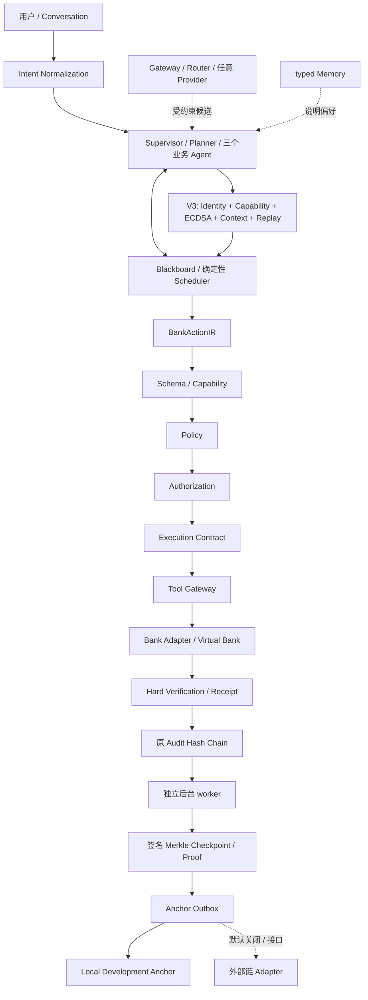

# Phase 4 Architecture Review 与实施方案

分析完成于 2026-10-06，先于 Phase 4 代码修改。基线命令 `python -m unittest discover -s tests -v`：**151 tests / 187.285s / OK**，无失败项。已核对 V1 Specification / Brief、Phase 2、Phase 3.1–3.3、运行时、持久化、Capability、消息及执行安全代码和现有测试。

## 真实基线与冻结边界

五个业务 Agent，Service inactive；Blackboard + 进程内 Bus + 确定性 Scheduler。模型候选没有金融权限，Memory 只保存受限偏好 / 引用。金融写只在 Tool Gateway 调用 Bank Adapter；银行自身原子事务负责余额、双边账本和幂等。动作、授权、合约、核验分别校验；执行不确定进入 MANUAL_REVIEW，不重试。

`BankActionIR → Schema → Capability → Policy → Authorization → Execution Contract → Tool Gateway → Bank Adapter → Verification → Receipt / Audit` 完整保留，不修改金融模块算法或银行业务语义。

消息 V2 是 HMAC-SHA256，不是非对称身份。根密钥按 Agent / epoch 派生消息密钥；版本、撤销、宽限期和 nonce 持久化。根密钥泄露能推导所有历史版本，不提供前向安全或公开不可否认性。V1 仅有首次初始化后的 300 秒兼容窗口。消息管理与 execution-contract-v1 用途分离，不能轮换金融根密钥来替代消息轮换。

Audit 保留追加触发器与 SHA-256 哈希链，现有回执 audit_ref 指向 RECEIPT_GENERATED。当前没有 Merkle、签名检查点、外部时间证据。数据库管理员可绕过触发器、截断尾部或重建链。单进程代码边界不防任意代码执行，数据库 / 密钥同机不是生产隔离。

## 技术决策

1. **ECDSA P-256 / SHA-256**：使用现有环境中的 cryptography 47.0.0（新增明确依赖），不手写曲线算法。Agent 各自随机密钥，Audit 检查点使用独立系统签名主体，不新增 Agent。SPKI 公钥、SHA-256 指纹；严格 DER / Base64 签名。消息与检查点签名有独立域前缀。
2. **密钥保管**：加密 PKCS8 文件放在数据库旁独立 key store，SQLite 只存公钥、版本和状态。加密密码由原根密钥按独立用途派生；文件 / 目录限制当前用户权限，私钥不进 Blackboard、API、日志或提示。重启核对公私钥与登记，不因丢失文件静默重建。暂不声称 HSM、进程隔离或受损根密钥恢复。
3. **明确迁移**：Config 的已有 Python 调用保留 communication_version=2，旧 151 项及历史 Demo 不修改。正常 `Config.local()` 启动默认 V3，可显式选择 V2 兼容环境。V3 服务只接收 V3，数据库一旦升级保存版本下限，禁止回到 V2；绝不依据收到消息自动选择算法。执行合约 HMAC 保留内部用途，原 signing.key 不替换。
4. **诚实身份**：内部 cryptographic identity URI `urn:trusta:<deployment_uuid>:<agent_id>`，不是 DID。did:key 能本地解析密钥，但不能单独满足本工程身份生命周期、权限承诺更新和撤销；本期不引入 DID 方法 / Resolver 网络生态。保留 IdentityResolver 接口。
5. **能力绑定**：登记 agent_id、identity_uri、公钥 / 指纹、key_id / version、当前 capability_hash、agent_version、ACTIVE / SUSPENDED / REVOKED、创建 / 更新 / 轮换时间。能力摘要来自确定性 Registry 的银行 / 推理 / Memory 命名空间，不来自消息。管理员同步合法能力变更后旧承诺失效，未经同步的配置变更失败关闭；不能由签名或注册行赋予新金融能力。
6. **V3**：封闭字段，全部签名；任务 / 步骤 / 接收者 / payload_ref / revision / capability_hash / 时间 / nonce / 算法均绑定。签名验证和情境验证完成后，nonce 与 MESSAGE_ACCEPTED 在同一事务提交，然后写 Agent 结果。只签 REQUEST、PLAN、ACTION_PROPOSED、READ_ONLY_REPORT；执行证据通过签名检查点保护，不签 token / UI event。
7. **序列化**：保留已有 action / event / payload 哈希，避免改变审批和历史回执。新签名对象使用明确标记的 TRUSTA-JSON-v1：UTF-8、排序键、紧凑 JSON、禁止所有浮点数和代理字符，安全时间用整数毫秒。不是 RFC 8785 JCS；第三方复核需遵循本 profile，未来跨语言可版本化引入 JCS，不能静默改变旧哈希。
8. **Merkle**：保留 Hash Chain，在已验证日志上创建有界、连续、不重叠批次。采用 RFC 6962 风格 SHA256(0x00 || event_hash bytes) 叶 / SHA256(0x01 || left || right) 内节点，按最大二次幂递归划分，禁止模糊的末叶复制。序号 / 叶数 / root / 前检查点摘要 / signer / 创建时间全部签名，anchor 状态独立，避免状态更新改变签名对象。
9. **记录证明**：event_id / receipt_id / transaction_id 解析到现有 audit_ref；身份及用户归属检查后返回事件哈希、签名检查点、严格路径证明及锚定状态。旧 Receipt 原文不修改，通过独立查询构成 versioned proof bundle。离线验证需要外部可信公钥 / 检查点 pin，不能信任证明自带公钥就声称第三方可信。
10. **Anchor**：单独后台维护命令读取日志、形成检查点并处理持久化 outbox；金融请求不等待检查点生成或链确认。LocalDevelopmentAnchor 有真实持久化记录和根摘要核对，明确不是链。AuditAnchor 协议预留外部 adapter；真实链 feature flag 默认关闭，未提供链节点 / 合约 / 密钥，外部 adapter 本期仅边界，不伪造 CONFIRMED。只交付 root commitment；DID / ZKP 仍接口。

上述选择参考 [cryptography ECDSA 文档](https://cryptography.io/en/47.0.0/hazmat/primitives/asymmetric/ec/)、[DID Core](https://www.w3.org/TR/did-core/)、[RFC 6962](https://www.rfc-editor.org/rfc/rfc6962.html)、[RFC 8785](https://www.rfc-editor.org/rfc/rfc8785.html)。这是本工程适配判断，不是对完整 DID / CT / JCS 实现的声明。

## 架构与数据流

## 风险与处理

主要风险：单机根密钥与所有私钥共址；SQLite 管理员可篡改 Registry 与本地 anchor；多进程写入不具备原系统之外的隔离；旧算法兼容误成为降级入口；权限变更后的旧承诺复用；宽限期与历史证明验证混淆；不可信 proof 公钥替换；异步锚定中断 / 重复提交。处理方式分别为加密 / 访问权限及真实限制说明、登记完整性封印、V3 持久化下限、确定性能力核对、消息撤销与历史签名状态分开返回、外部 pin 必需、持久化幂等 outbox。冻结过去的签名证明不说明操作合法，更不说明某个人确实授权；金融审批与核验仍是独立关卡。

## 分阶段实施

| 阶段 | 原因 / 新模块 | 修改模块 / 数据 / API | 兼容、测试与失败处理 |
|---|---|---|---|
| 4.1 | security/crypto.py、crypto_registry.py、message_v3.py | Config、Service、Capability Registry、Persistence；新增 identity / key / trust state；安全状态只读 API | 原 151 不变；V3 模式攻击、轮换、撤销、能力更新、重启、拒绝降级；损坏 / 丢失 key fail closed，消息失败不消费 nonce |
| 4.2 | audit_trust/merkle.py、checkpoints.py、records.py | 新增 checkpoint / leaf 索引；认证 GET proof；不重写事件 / Receipt | 单叶 / 奇数叶 / 修改叶 / 路径 / 检查点 / 源记录；旧 Receipt 升级后可查询；不存在批次返回待 checkpoint，不造证明 |
| 4.3 | audit_trust/anchor.py、scripts/audit_worker.py | checkpoint outbox、local anchor；离线运维，不开放客户管理端点 | PENDING / SUBMITTED / CONFIRMED / FAILED，重启 / 重复 / mismatch / 故障；anchor 故障不会进入金融主路径 |
| 4.4 | benchmarks/security_benchmark.py、Phase4 Demo、独立验证 CLI | 新 Phase4 测试 / 实测 JSON / 文档 / 只读证明展示 | 18 类攻击；合法消息 / proof 基准；p50 / p95 sign、verify、checkpoint；全部原测试 + 新测试 + 三个 HTTP Demo；失败时基准退出非零 |

所有新增表 CREATE IF NOT EXISTS，保留原任务、合约、回执及事件格式。无架构重大冲突，按方案继续实施。结果、实际文件清单及限制在 phase4-cryptographic-trust.md 中交付。
