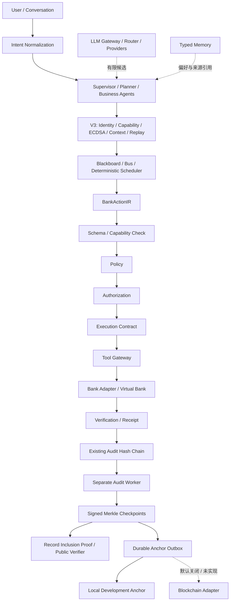
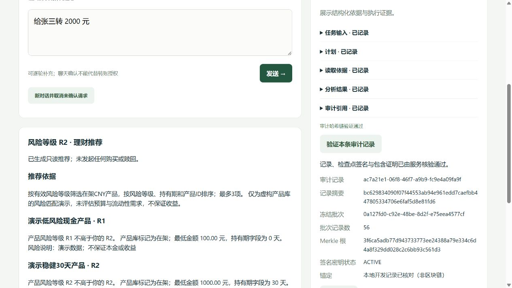

# TRUSTA Phase 4 — Cryptographic Trust & Verifiable Audit

交付日期：2026-10-06（Asia/Shanghai）。Phase 4 的本地实现与验收完成：全量 **285 项测试通过**；独立基准 **18 类 / 90 次攻击全部检测或阻止**；三个原业务场景在 V3 下完成。真实 Blockchain、DID、ZKP 未实现，不属于本次已完成能力。下文覆盖用户要求的 18 项交付。

## 1. Architecture Review

编码前完成 [架构评估与分阶段方案](phase4-architecture-review.md)，先运行原有 **151 tests / 187.285s / OK**。没有发现需要改变冻结金融架构的重大冲突。

基线实际采用 HMAC-SHA256 消息 V2，根密钥派生各 Agent / epoch 密钥，已有轮换、撤销、宽限和持久化 nonce；它不能供仅持有公钥的第三方验签。已有 Audit 为追加式哈希链，能检测链内改写，缺少签名检查点和单记录包含证明。模型、Memory、Scheduler 仍受确定性安全边界约束。

本期改动位于通信、身份、审计和只读展示，不增加业务 Agent。Supervisor、Planner、Transaction、Finance、Wealth 五个 Agent 保留；Service inactive。`audit-checkpoint` 是系统签名主体，不参与任务规划、业务推理或金融执行。

## 2. 最终架构与数据流



Agent 消息在验签、身份与权限状态、载荷引用、任务上下文全部通过后，才在同一 SQLite 事务中消费 nonce 并追加 MESSAGE_ACCEPTED。业务结果随后经既有 Blackboard / Scheduler 规则推进。签名通过不能授予金融权限。

金融路径完整保留：**BankActionIR → Schema → Capability → Policy → Authorization → Execution Contract → Tool Gateway → Bank Adapter → Verification → Audit**。原动作哈希、精确用户审批、合约内部 HMAC、银行幂等与核验语义未替换。LLM / Memory / Agent 没有直接银行写接口。

只读 Finance / Wealth 仍通过受 Capability 约束的原 Gateway 读取银行数据。审计 worker 独立进程读取日志，不恢复业务任务、不初始化银行、不调用金融执行；银行请求不等待检查点、锚定或外部确认。

## 3. 技术决策与原因

| 决策 | 原因与边界 |
|---|---|
| ECDSA P-256 / SHA-256，cryptography 47.0.0 | 使用成熟库实现真实非对称签名，不手写曲线，不依赖模型判断密码学正确性 |
| 各主体独立随机私钥 | 新消息密钥不再由共享根直接确定性派生；仍由本地服务保管，不等于独立进程隔离 |
| 加密 PKCS8 文件 + SQLite 公钥登记 | 不把私钥放进 Blackboard、数据库、API、日志或提示；支持重启恢复 |
| 内部 URN 身份 | 满足当前持久化身份与生命周期，不将本地 Registry 包装成 DID |
| TRUSTA-JSON-v1 显式签名 profile | 新签名禁止浮点时间与模糊字段；不静默改变旧 action / payload / event 哈希，不声称 RFC8785 JCS |
| Hash Chain + 签名 Merkle 批次 | 保留原链；对历史事件新增紧凑单记录证明和公开验签 |
| 不可变检查点，可变 anchor 状态分离 | 后台状态变化不破坏已签名对象 |
| 公钥必须由验证者预先信任 | 拒绝“攻击者换自己的公钥和签名”式自证明 |
| 本地异步 anchor 先交付 | 可展示真实持久化、幂等、失败恢复；不引入链节点、钱包、合约与转账耦合 |
| 显式兼容配置 + 持久化 V3 下限 | 原测试与历史脚本保持兼容，V3 不接受降级消息或退回 V2 启动 |

算法参考和推导见 [架构评估中的一手来源](phase4-architecture-review.md)。本实现不是完整 DID / Certificate Transparency / JCS 标准实现或密码模块认证。

## 4. 新目录与完整修改清单

```text
backend/
  security/
    crypto.py                   # 新：签名 / 公钥 / 本地加密密钥库
    crypto_registry.py          # 新：持久化身份与密钥生命周期
    message_v3.py               # 新：严格签名信封
    registry.py                 # 改：确定性能力快照 / 承诺
    capability.py               # 改：活跃身份检查
    replay_protection.py        # 改：事务内 nonce 消费
    extensions.py               # 改：准确报告能力状态
  audit_trust/                  # 新：审计职责，不是 trusted 大模块
    __init__.py
    merkle.py
    checkpoints.py
    records.py
    anchor.py
  llm/gateway.py                # 改：配置模型调用前身份检查
  memory/store.py               # 改：Agent 读取前身份检查
  config.py                    # 改：通信 / key store / anchor 配置
  persistence.py               # 改：附加表与不可变触发器
  service.py                   # 改：V3 装配 / 接收 / 证明与状态
  audit.py                     # 改：损坏事件验证返回失败
  server.py                    # 改：认证证明 GET / 启动 profile 显示
scripts/
  audit_worker.py              # 新：独立后台维护命令
  manage_crypto_identity.py    # 新：本地身份运维
  verify_audit_record.py       # 新：仅公钥独立复核
  phase4_demo.py               # 新：三个实际 HTTP 场景
  rotate_message_key.py        # 改：V3 拒绝操作旧 HMAC key ring
benchmarks/
  __init__.py
  security_benchmark.py        # 新：独立攻击与性能基准
tests/
  test_phase4_communication.py  # 新：24 项
  test_phase4_audit.py          # 新：21 项
  test_phase4_execution.py      # 新：33 项原执行断言在 V3 重跑
  test_phase4_platform.py       # 新：48 项原只读 / Memory / 会话断言在 V3 重跑
  test_phase4_api.py            # 新：7 项
  test_phase4_scenarios.py      # 新：1 项完整 HTTP / 重启 Demo
frontend/
  index.html                   # 改：单记录证明面板
  app.js                       # 改：查询 / 展示 / JSON 导出
requirements.txt               # 新：明确 cryptography 依赖
start.ps1                      # 改：隐藏后台 worker / 生命周期清理
.env.example                   # 改：V3 与默认关闭链配置
.gitignore                     # 改：忽略私钥目录
docs/
  phase4-architecture-review.md
  phase4-cryptographic-trust.md
  phase4-security-benchmark.json
  phase4-demo.json
  phase4-record-proof.json
  phase4-audit-public.pem       # 仅演示公钥，无私钥
  phase4-tests.txt
  phase4-validation.json
  phase4-ui.png
```

README、architecture、assumptions、api、validation 更新为当前交付；Phase 1–3 文档和测试保留历史含义。未修改金融 Schema / Policy / Authorization / Contract / Gateway / Adapter / Verification 的算法，没有新增银行业务。

## 5. ECDSA / Identity 实现与密钥管理

`LocalKeyStore` 生成随机 SECP256R1 密钥。公钥为 SPKI PEM，指纹为公钥 DER 的 SHA256。签名为 ECDSA-SHA256 DER / canonical Base64；消息与检查点有各自签名域。密钥文件为加密 PKCS8，密码按独立用途由原 `signing.key` 派生。文件独占创建并 fsync，Windows 目录 ACL 限制当前用户；其他平台使用目录 0700 / 文件 0600。运行中私钥缓存在可信进程内。

正常目录为数据库旁 `<database>.keys/`，可以配置 `TRUSTA_CRYPTO_KEY_DIR`。启动核对加密文件、公钥和登记；文件缺失、根密钥不匹配或 Registry 封印损坏失败关闭，不静默创建替代身份。SQLite 不含私钥。历史加密私钥保留，未实现安全擦除、HSM 或前向安全。

Agent 状态 ACTIVE / SUSPENDED / REVOKED。密钥 ACTIVE / VERIFY_ONLY / REVOKED。轮换生成随机新密钥并递增 key_version，旧密钥只验证，宽限最多 300 秒。过期或显式撤销旧密钥拒绝实时消息；当前密钥不能直接撤销，先轮换或停用身份。身份 REVOKED 为终态。身份、轮换、撤销、能力同步有审计记录且重启保留。

本地操作示例（先停业务服务，避免并发运维）：

```powershell
python -m scripts.manage_crypto_identity --agent transaction --rotate --grace-seconds 300
python -m scripts.manage_crypto_identity --revoke-key key-<old-uuid>
python -m scripts.manage_crypto_identity --agent finance --status SUSPENDED
python -m scripts.manage_crypto_identity --agent finance --sync-capabilities
```

同步仅绑定已审核的代码能力，不接受用户自填权限。没有 HTTP 身份管理、密钥轮换或授予金融权限端点。

## 6. Trusted Message V3

严格封闭字段：`schema_version=3`、`canonicalization`、message_id、task_id、step_id、sender_agent、receiver_agent、sender_key_id、sender_identity、message_type、payload_ref、payload_hash、payload_version、capability_snapshot_hash、issued_at、expires_at、nonce、signature_algorithm、signature。签名覆盖 signature 之外全部字段。

时间为整数毫秒，TTL 最多 300000ms，允许未来时钟偏差最多 30000ms。算法固定 ECDSA-P256-SHA256；额外字段、错误 profile、非整数版本 / 时间、未知身份、错绑公钥、无效 DER/Base64、过期、撤销、陈旧载荷 / 任务 revision、错误交接方向均拒绝。signed profile 禁止所有浮点数与 Unicode surrogate，采用排序键、紧凑 UTF8 JSON。旧有限浮点事件时间戳保留原 hash 算法，通过 event_hash 纳入 Merkle。

接收顺序：结构与算法 → 登记身份与当前能力 → 公钥签名 → 载荷 hash → 接收者与时间 → 原任务 / DAG / 引用情境 → nonce 唯一插入 + MESSAGE_ACCEPTED 同事务 → 既有结果与步骤更新。验证失败不会先消费 nonce 或推进任务。请求、计划、动作提案、只读报告使用 V3；银行合约保持原内部 HMAC。

兼容性：已有 Python `Config(...)` 默认 V2，保留历史脚本和原 151 项测试；正常 `Config.local()` / 启动脚本默认 V3。V3 接收器不协商算法、不回退 HMAC；升级数据库保存最低版本 3，随后 V2 启动失败。旧 V2 只能显式用于尚未升级的独立数据库。

## 7. Agent / Capability Registry

内部身份 `urn:trusta:<deployment_uuid>:<agent_id>`，不是 DID。字段包含 agent_id、identity_uri、public_key、public_key_fingerprint、key_id、key_version、capability_hash、agent_version、status、created_at、updated_at、rotated_at。注册数据由本地根密钥域分离 HMAC 封印；持久化部署 ID 和通信下限也有封印。

CapabilityRegistry 仍是唯一授予银行 / inference / Memory 权限的确定性来源。`commitment(agent)` 对三类权限快照计算摘要，登记与消息绑定同一个摘要；签名/验签/银行读/Memory 读/实际模型调用核对当前活跃身份。改消息、改公钥行、改承诺不会赋权；代码能力改变后未同步则失败关闭，审核后同步会更新 agent_version，旧承诺消息失效。

身份公钥绑定和能力承诺解决本地登记一致性，不构成去中心化凭证。原 Agent Registry 的 Service inactive 保持不变。IdentityResolver / ProofVerifier 仍是未来扩展接口。

## 8. Merkle Audit

原事件哈希链、事件文本、历史 Receipt 不重写。后台先核验原链和既有检查点存储，再对连续新事件生成不可变批次，默认最多 256 条，可指定最多 4096 条。叶为 `SHA256(0x00 || event_hash_bytes)`；内部节点为 `SHA256(0x01 || left || right)`。奇数叶使用最大二次幂递归划分，不复制末叶。

检查点签名覆盖 schema_version、canonicalization、tree_algorithm、checkpoint_id、first/last_event_sequence、leaf_count、merkle_root、created_at、previous_checkpoint_hash、signer_identity、signer_key_id、public_key_fingerprint、signature_algorithm。检查点和叶索引有 SQLite UPDATE/DELETE 拒绝触发器。新检查点、叶和 PENDING outbox 同事务保存。生成器不额外追加“生成检查点”事件，避免自身不断产生新批次。

证明严格绑定 index/count/path 结构，拒绝多余或错向 sibling。源事件、冻结叶、root、签名与检查点链逐一校验。历史签名可做数学复核，但当前 signer_key_status 单独报告；被撤销的历史密钥签名并不自动等于可信的历史时间证据。

## 9. Record Proof 示例与独立复核

认证接口：`GET /api/audit/proof?audit_event_id=...`，或 receipt_id / transaction_id，必须恰好一个非空查询参数，不能重复、增加未知参数。先检查当前客户任务归属，拒绝其他客户和全局运维事件。尚未生成批次返回 AUDIT_CHECKPOINT_PENDING；不即时伪造 root 或 CONFIRMED。

实际 Demo 的 [完整 proof bundle](phase4-record-proof.json) 核心字段：

```json
{
  "schema_version": 1,
  "receipt_schema_version": 1,
  "audit_event_id": "b525b239-5024-495a-9709-2ae909d26725",
  "event_hash": "8e14e24ce167e26f9aa587190f622f7731a8168e7bd429c7e5e426a57cd57512",
  "event_sequence": 47,
  "leaf_index": 46,
  "merkle_root": "2a5d7c539256623a7835fec237914aaa7b1586200cfae48842dceab4a105d89b",
  "signature_status": "VALID",
  "anchor_status": "CONFIRMED",
  "signer_key_status": "ACTIVE"
}
```

完整对象还包含原 event、Receipt、七个路径节点、102 叶签名检查点及 anchor 元数据。`anchor_status` 是顶层可变字段，不放进签名检查点；本例 `is_blockchain=false`、`externally_verified=false`。

```powershell
python -m scripts.verify_audit_record docs/phase4-record-proof.json --trusted-public-key docs/phase4-audit-public.pem
```

实测 `record_verified=true`。该 CLI 仅需 proof 和预先信任的公钥，不连接数据库，不持有私钥；可追加 `--expected-checkpoint-hash` 绑定已知检查点。它复算 event_hash、包含路径、签名及 Receipt 的原审计 payload_hash，忽略证明自带的成功标志与公钥作为信任源。修改回执后返回 false。

**演示 PEM 是本地测试 fixture 公钥**，用于展示 public-only verification，并未通过真实外部渠道认证。CLI 中 externally_pinned_public_key 表示调用方提供 pin；不能据此宣称 Demo 已有外部身份认证。离线 CLI 不认证 mutable anchor 状态，也不独立判定实时吊销，实际部署需可信 key pin / 吊销与时间策略。本地服务查询会报告当前 key 状态并核对本地 anchor。

## 10. Audit / Blockchain Anchor 状态

实现 `AuditAnchor` 提交与查询协议、真实持久化的 `LocalDevelopmentAnchor`、独立 worker 和 outbox：PENDING → SUBMITTED → CONFIRMED / FAILED。按 root + checkpoint_hash 幂等，保存提交引用、尝试次数、状态与脱敏错误码；重启续查已提交任务，FAILED 通过本地操作明确重试。adapter inspect 返回的 root / digest 不一致视为失败。

LocalDevelopmentAnchor 的 CONFIRMED 表示本地保存记录已核对，**不是链上最终性或第三方时间戳**。只存 root commitment、检查点摘要和运维状态，不提交业务 PII、原始消息或私钥。

`TRUSTA_BLOCKCHAIN_ANCHOR_ENABLED=false` 为默认。真实链 adapter 尚未实现；设 true 选择明确报错的 UnconfiguredBlockchainAnchor，任务记录 FAILED / BLOCKCHAIN_ADAPTER_NOT_IMPLEMENTED，不伪造成功；金融流程仍可运行。没有节点、钱包、合约部署、链交易或外部验证证据。

## 11. Security Benchmark 设计

`benchmarks/security_benchmark.py` 独立运行，不依赖 unittest / mock 成功返回。每轮真实 SQLite 沙箱，执行签名/验证、金融网关、检查点与 proof；故障注入直接修改隔离测试数据并恢复，不接触日常银行。预期特定拒绝码，意外异常不计为成功检测；比较银行交易数而非仅检查错误字符串。

默认五轮，每轮 18 类攻击、20 个合法消息与一个攻击后合法恢复消息。每轮追加 128 个合成审计事件，实测批次 64 / 64 / 33（另含实际业务审计）。每批验证首尾合法证明。包含正向控制、合法路径恢复、样本数、原始耗时及明确分母。检测失败、误拒绝、非法银行写入使进程退出非零。

```powershell
python -m benchmarks.security_benchmark --trials 5 --valid-per-trial 20 --audit-events 128 --output docs/phase4-security-benchmark.json
```

## 12. Benchmark 实际结果

2026-10-06 本机运行，28.940 秒，`passed=true`；[机器可读报告](phase4-security-benchmark.json) 含每次观察码与原始时延。

| 攻击类别 | 检测 / 尝试 |
|---|---:|
| 伪造 Agent identity | 5 / 5 |
| 无效签名 | 5 / 5 |
| payload 篡改 | 5 / 5 |
| nonce replay | 5 / 5 |
| 过期消息 | 5 / 5 |
| revoked key | 5 / 5 |
| 旧 key 超出宽限 | 5 / 5 |
| capability 提权 | 5 / 5 |
| capability snapshot 篡改 | 5 / 5 |
| 未授权 tool 调用 | 5 / 5 |
| authorization / action_hash 不匹配 | 5 / 5 |
| 重复金融执行 | 5 / 5（只保留一笔交易） |
| 历史 Audit event 篡改 | 5 / 5 |
| Merkle leaf 篡改 | 5 / 5 |
| 无效 Merkle path | 5 / 5 |
| Checkpoint 签名对象篡改 | 5 / 5 |
| Anchor root mismatch | 5 / 5 |
| 签名算法降级 | 5 / 5 |

| 实测指标 | 分子 / 分母 | 比率 |
|---|---:|---:|
| 伪造检测 | 10 / 10 | 100% |
| 消息篡改检测 | 10 / 10 | 100% |
| Replay 阻止 | 5 / 5 | 100% |
| 未授权执行产生银行写入 | 0 / 15 | 0% |
| Audit 篡改检测 | 10 / 10 | 100% |
| 合法 Merkle proof 验证 | 30 / 30 | 100% |
| 合法消息 / proof 误拒绝 | 0 / 135 | 0% |

指标组合定义来自实际攻击类别，18 类表和分类比率的分母不是同一个集合。135 为 105 个合法消息 + 30 个合法 proof。这些是本地已覆盖攻击的观察率，不能外推为生产总体安全概率。

## 13. Crypto performance 数据

Windows 11 / Python 3.13.1 / cryptography 47.0.0 / OpenSSL 4.0.0。单位 ms。

| 路径 | 样本数 | mean | p50 | p95 | max |
|---|---:|---:|---:|---:|---:|
| 签名 | 100 | 7.966 | 7.653 | 10.087 | 13.618 |
| 验签 | 100 | 3.047 | 2.934 | 3.574 | 5.587 |
| 检查点生成 | 15 | 10.381 | 10.012 | 15.427 | 15.427 |

签名包括 Registry 查询与内存私钥签名，排除初始化 / 解密；验签包含身份、能力与任务上下文，排除 nonce 提交与审计写入；检查点包括全链核验、批次 Merkle、签名和持久化 outbox，**不是仅曲线算法微基准**。

每种 profile 每场景五轮，交替运行 V2 / V3 顺序；从 task 创建到完整结果，转账含沙箱用户授权函数，排除启动、HTTP、人类思考与模型调用。

| 场景 | V2 p50 / p95 | V3 p50 / p95 |
|---|---:|---:|
| TRANSFER | 696.744 / 1230.607 | 727.568 / 1183.731 |
| BILL_ANALYSIS | 424.422 / 447.772 | 416.900 / 978.728 |
| WEALTH_RECOMMENDATION | 426.765 / 427.988 | 392.073 / 438.292 |

普通 Windows 主机有明显抖动，五样本 p95 等于最大值；不能据此宣称 V3 更快或生产 SLA。原始 samples 保留，未删除离群值。批次数受限，但全历史核验仍随日志长度增长，本次不证明大规模吞吐。

## 14. 全量测试、迁移与运行

最终 `python -m unittest discover -s tests -v`：**285 tests / 207.554s / OK**。原 151 项测试未删除、未修改断言；新增 134 项，其中 81 项把原执行 / 场景 / Memory / Conversation 断言在 V3 再运行。另有真实 ECDSA、身份生命周期、能力承诺、原子 nonce、Merkle、锚定故障、查询隔离与完整 HTTP Demo 覆盖。

[完整测试输出](phase4-tests.txt) 与 [机器验证摘要](phase4-validation.json)。`compileall`、前端语法检查、启动脚本 PowerShell 解析通过。实际浏览器显示只读理财报告和单记录证明核验通过，无 warn/error 日志；[页面截图](phase4-ui.png)。证明 JSON 的脚本导出与独立 CLI 验证通过；浏览器导出按钮已触发，in-app browser 的下载事件未返回，因此不声称已验证浏览器下载文件。

```powershell
python -m pip install -r requirements.txt
.\start.ps1
```

正常入口默认 V3。start.ps1 隐藏启动独立 worker，退出时清理本次 worker。手动启动时：

```powershell
python -m backend.server
# 另一个终端：
python -m scripts.audit_worker --watch
```

升级前停止旧服务并备份 DB、原 `data/signing.key`、全部加密 key store 与令牌。新增表 CREATE IF NOT EXISTS，原数据 / 事件 / Receipt 不重写，旧回执可被后续检查点覆盖。第一次 V3 启动初始化登记与随机私钥，持久化下限 3；不能把配置改回 2 回滚。不能只备份 DB 丢弃密钥，也不能替换 signing.key 来轮换消息身份。缺失 / 损坏密钥应从对应备份恢复或按后续受损迁移方案处理，不能自动重建。

## 15. 三个原业务场景与 Demo

运行 `python -m scripts.phase4_demo`，生成独立沙箱实际 HTTP 报告、proof JSON 和演示公钥，日常银行数据不变。[本次结果](phase4-demo.json)：

| 请求 | 结果 |
|---|---|
| 给张三转 2000 元 | COMPLETED / SETTLED / VERIFIED；金额 200000 分；余额 1000000 → 800000 分；仅一笔交易；审批 action_hash 保持一致 |
| 分析 2026-09 消费 | COMPLETED；净消费 542500 分；3 条异常标记；读取不改变银行余额 |
| 推荐适合我的理财产品 | COMPLETED；权威银行风险 R2；sandbox-r1 / sandbox-r2；无购买 / 赎回操作 |

Demo 流程：V3 创建任务 → 额外合法消息验证 → Transaction key 轮换 → 服务重建后 replay 被拒绝 → 旧 key 撤销 → 精确用户授权并转账 → Finance / Wealth 只读任务 → 金融流程结束后运行 worker → receipt_id 查询 proof → 仅公钥复核 → 修改 Receipt 检测失败 → 再重建服务。

重启检查：Agent registry、key 轮换版本、撤销状态、nonce 防重放、检查点证明和旧格式 Receipt **全部保持正确**。Audit hash chain 有效。证明的 CONFIRMED 仅为本地开发 anchor。



## 16. 能力状态清单

| 状态 | 能力 |
|---|---|
| **IMPLEMENTED & VERIFIED** | ECDSA V3 / 本地随机加密 key store / 身份登记、轮换、暂停、撤销 / 当前 Capability 承诺与权限核对 / nonce 防重放与 context / 持久化禁止降级 / 原金融链与三个场景 / Hash Chain / 签名 Merkle 批次 / 单记录证明 / public-only CLI / 本地异步 outbox、幂等、状态恢复与 root 核对 / 独立 benchmark |
| **IMPLEMENTED BUT NOT EXTERNALLY VERIFIED** | 内部 cryptographic identity 的实际主体归属未由外部机构认证；Demo 公钥 pin 未经真实外部渠道认证；本地 anchor 已通过本机记录核对，但没有外部时间 / 网络确认 |
| **INTERFACE ONLY / NOT IMPLEMENTED** | DID 方法与网络 Resolver、真实 Blockchain adapter / 合约 / wallet / anchor finality、ZKP、HSM/KMS、生产身份认证 / 真实银行 / 不可信 Agent 进程隔离 / 跨语言 JCS 验证器 |

ECDSA 和 Merkle 是本期真实代码，不再作为接口占位。Blockchain 开关和 adapter 协议不代表链集成已实现。ZKP 不进入主流程。

## 17. 已知限制与 DoD

1. 同机根密钥和全部私钥由可信进程可访问；同进程任意代码执行或 OS 用户失陷仍可签名。随机 key 轮换不是 HSM、不可否认性或前向安全；历史加密私钥保留，根泄露迁移尚未实现。
2. Registry 封印和 SQLite triggers 不抵抗拥有根密钥 / 数据库管理权的攻击者。没有外部已知 root 时，整库回滚、删除整批尾部或重建身份仍不具备可信外部检测依据。独立保留的 key / checkpoint pin 能约束已知批次，但不提供可信时间或全历史完整性。
3. Inclusion proof 证明某 event_hash 属于已签批次，不证明业务事实、真人身份、授权合法性或银行真实性；这些仍依赖原 Policy / Authorization / Verification 与正确环境。
4. 历史签名有效与当前密钥撤销是两种状态。离线验证需要调用方可信密钥、检查点 pin 和外部吊销 / 时间策略；导出对象的可变状态不自证可信。
5. Worker 不等待外部服务阻塞银行请求，但 SQLite 同库写事务会竞争。生成器和启动检查全历史，日志增长后需快照 / 增量核验与压力测试。支持本地单 worker；多 worker lease / 分布式任务协调未实现。
6. 无真实链确认、外部 LLM 推理质量或真实银行验证；本地攻击统计不是生产渗透测试。手动运维建议停服务。API 仍为原本地令牌沙箱认证。

| DoD | 证据 |
|---|---|
| A–C 合法非对称通信、拒绝攻击、禁止提权 | communication tests + 独立 benchmark 90 次 |
| D–E 原金融链、SETTLED / VERIFIED / 幂等 | V3 33 项执行回归 + HTTP Demo + 重复执行 benchmark |
| F–H Hash Chain、单记录证明、篡改检测 | audit tests + public-only CLI + event / leaf / checkpoint 注入 |
| I 异步 anchor 不进入金融路径 | 独立 worker + 慢 / 故障 adapter 测试，保留 SQLite 竞争限制 |
| J 可重复机器基准 | benchmark 独立命令、JSON 原始观察与 latency |
| K 原功能回归 | 全部 151 原测试 + V3 平台重跑，最终 285 / OK |
| L 诚实能力描述 | 本文三类状态，is_blockchain / externally_verified 明确 false |

## 18. Phase 5 建议

先做可信密钥分发与隔离：把 Gateway / Audit signer 与不可信推理进程隔离，明确外部 key pin、吊销和受损恢复，接入 OS keystore / KMS 后再谈生产签名身份。然后测量大量历史日志下 worker 的 DB 锁等待与查询延迟，采用版本化快照或增量核验，补跨语言证明验证器。

比赛展示继续使用三个原业务场景，重点展示“签名 / replay 拒绝 → 精确金融授权 → 单记录 proof → 篡改检测”，给出真实 benchmark 与本地 anchor 标识。若确需外部可信时间，再选一个测试链实现 AuditAnchor、保管钱包和验证确认，仍在金融路径之外；DID 按实际身份治理需求选择，ZKP 仅在明确隐私证明需求出现后评估。
