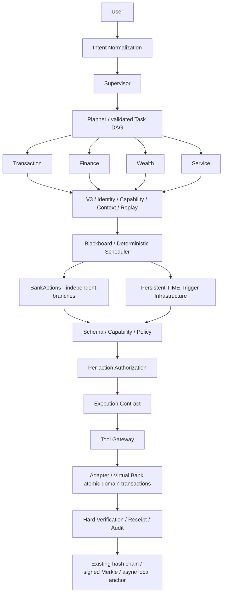

# Phase 5 Architecture Review（编码前）

2026-10-06，基线 **285 tests / 204.365s / OK**。核对原规格、Phase 2–4 文档、实际 Action / Schema / Policy / Authorization / Contract / Gateway / Adapter / Bank / Verifier / Receipt、Registry、Blackboard、Scheduler、V3、测试与安全基准。原冻结金融链完整，业务扩展可以通过新增领域、能力映射与确定性分支完成，没有需要重新决定的架构冲突。

## 真实 Gap Analysis

| 能力 | 编码前状态 | 实际证据 / 差距 |
|---|---|---|
| 姓名转账 | IMPLEMENTED | Transaction.recipient → payee.resolve 按客户/name，唯一匹配才提案 |
| 手机号 / alias | NOT IMPLEMENTED | payees 只有 id/customer/name/is_new，无手机号或备注 |
| 明确账户 | PARTIAL | API 接收 source_account_id 并核对归属，自然语言不解析账户 |
| 定时 / AA | NOT IMPLEMENTED | 无持久化 Job / split 领域，不能用 sleep 弥补 |
| 分类/月分析/异常 | IMPLEMENTED | 消费 PURCHASE/REFUND、自然月、确定性统计 / 提示；不是欺诈判断 |
| 风险匹配与推荐 | IMPLEMENTED | 风险/产品通过 Gateway 读取，纯只读 |
| 比较/完整适当性/申购/赎回 | NOT IMPLEMENTED | 无 Portfolio、投资交易或现金结算；旧 schema 仅 TRANSFER |
| Card / Subscription / DirectDebit | NOT IMPLEMENTED | 当前表、manifest、Agent 能力和执行方法均不存在 |
| DAG / dependency | PARTIAL | 真正持久化步骤与依赖，但 PlanValidator 固定三种串行模板 |
| 跨场景 / parallel / 多动作审批 | NOT IMPLEMENTED | Blackboard 单 policy / authorization / receipt，无实际组合执行 |
| pause/resume | PARTIAL | 原等待授权与会话持久化；无 WAITING_TIME / due job |
| V3 / Audit / proof | IMPLEMENTED | 真实 ECDSA 与 signed Merkle；本地 anchor，无真实链 |

## 数据与状态机

- 新增 payee_contacts（客户范围 phone/alias 与 ACTIVE 状态），不重写原 payees；新账户选择仍需归属。
- cards：card_id、customer_id、account_id、type、ACTIVE/FROZEN/LOST/CANCELLED、整数限额、三类布尔交易开关、version/created_at。仅 ACTIVE↔FROZEN，限额 / 控制要求 ACTIVE；LOST/CANCELLED 不可通过解冻恢复。本期不开放挂失 / 销卡操作。
- subscriptions / direct_debits：商户、客户/账户、整数金额/CNY、频率、下次扣费、状态、cancelable/source/version。ACTIVE→CANCELLED 或 ACTIVE→DISABLED，终态不恢复。候选检测读取独立权威历史扣费，唯一匹配实际订阅后才能提出取消；未知候选没有金融动作。
- portfolio：客户/账户/产品的沙箱本金份额、version、redeemable_at；投资 transactions 与双边 cash ledger。使用整数分、沙箱单位净值固定 1，不声称市场收益；购买转现金到投资结算账户，赎回反向记账。持有期与限制必须确定性检查。
- 新 BankActionIR V2 用 target / parameters 描述非转账动作，不把 card_id 假装 recipient_id。旧 TRANSFER IR、动作哈希及回执不重写。每个新动作持有真实 pre-state 与 expected post-state，严格 closed schema。
- scheduled_jobs：schedule_id/task_id/action_template/execute_at/Asia-Shanghai/status/created_by/authorization_binding/policy_snapshot/idempotency_key/action_id。PENDING_AUTH→SCHEDULED→EXECUTING→COMPLETED；到期失效 → REAUTH_REQUIRED，已知失败 FAILED，不确定 MANUAL_REVIEW。过期/状态改变重新生成动作，旧授权不得随新动作迁移。
- Task 保留旧字段并新增 action_records[]、candidates、scheduled_job_refs、action / auth / verification / receipt 集合。每动作独立 Schema / Policy / Authorization / Contract / Verification / Receipt。拒绝某动作只取消该分支，不默认批准其他动作。

## 架构与安全取舍

六 Agent：Supervisor / Planner / Transaction / Finance / Wealth / Service。Service 读取 Card/Subscription/DirectDebit 并提案；Finance 识别周期性候选；Wealth 比较与投资提案；Executor 独占所有写能力。没有其他业务 Agent。

所有领域写仍完整经过冻结链。适当性与限制同时在 Policy 和银行原子事务检查；执行前 Policy 重新核对，合约严格绑定动作类型对应的 capability。只读动作不生成写合约。模型候选不能成为银行事实、权限、条件或审批。LLM Evaluation Harness 通过既有 Provider Interface，默认 offline fixtures，不造真实模型实验。

原测试有 Service inactive、Wealth 只读、五身份等阶段性断言；不删除或改写。保留 Python Config 的 banking_version=4 显式历史兼容配置，正常 Config.local 默认 5，Phase5 要求 communication_version=3。Registry 按该本地可信配置装配六 Agent 和新权限，数据升级保存 banking 下限，禁止回降。升级只允许从已知 Phase4 承诺迁移到已审核 Phase5 承诺，不接受任意旧权限。原密钥、状态、历史签名、公钥和回执保留。

## DAG / Scheduled / Cross-scenario

复杂订阅请求：C01 Parse → {C02 Finance analysis, C03 Service authoritative list} 两个独立可并行就绪分支 → C04 Finance recurring detection → C05 Service unique authority resolution → 每个已解析订阅各一条 Schema→Policy→User Authorization→Execute→Verify→Receipt 分支。候选数量与依赖从实际银行结果生成，Planner 进行确定性图扩展，用户逐项决定。运行器保存每步状态和产物，展示真实协作，不用一条 prompt 代替。

定时转账允许用户提前批准精确现有 IR，但长期调度不延长金融授权 TTL；到期重查账户、余额、payee、Policy、action_hash、原授权与幂等。条件变化 / 期限失效必须暂停、生成新动作并重新授权。worker 不 sleep 后直接写 Bank；定时 job 存在数据库，时间触发只恢复受信执行链。不确定执行禁止自动重试。支持 TIME，BANK_EVENT / BALANCE_THRESHOLD / TRANSACTION_EVENT 本期不实现。

AA/Split 为整数分摊与待收款请求产物，不代其他人付款、不模拟外部催款，不新造银行权限。并行只用于相互独立读取 / 分析；写分支在银行事务和精确授权下逐项执行，冲突前置条件需要重新提案/确认。

## 实施计划

| 阶段 | 新 / 改模块 | 数据/API/兼容 | 测试与失败处理 |
|---|---|---|---|
| 5.1 Domain / Contract 扩展 | banking domain / seed、ActionV2、schema / suitability / policy / gateway / adapter / verifier | 附加表与 canonical 能力；旧 transfer 分支保留；Config 显式 profile | 真实 cash/portfolio/ledger、Card终态、owner、严格参数、expired/stale、能力拒绝 |
| 5.2 六 Agent 与业务 | ServiceAgent、Wealth/Finance/Transaction 提案与读取、Intent | 六 Agent Registry、公钥与能力承诺受控升级；只读及单动作查询/授权API | 所有写主体必须executor，签名V3、适当性、账户/手机号/alias唯一匹配、动作授权隔离 |
| 5.3 Runtime | 多动作 Blackboard、Planner扩展、Scheduler、TIME worker | Job/action关联，持久化WAITING_TIME/REAUTH_REQUIRED；原API兼容 | dependency/parallel readiness、部分拒绝、恢复/到期/风险升级、不确定执行/无重复记账 |
| 5.4 Benchmarks | Banking Task benchmark、Provider Eval harness / fixtures | JSON+CSV raw/expected/actual/reason，外部Provider显式注入 | 模糊/缺字段/多轮/风险/跨场景/非法/幻觉，真实模型无凭据就标 offline |
| 5.5 回归 / Demo | 六HTTP场景脚本、原Security Benchmark和新业务安全注入、文档 | 不重点改Web UI；不接真实银行/链/DID/ZKP | 原285断言原封保留 + 新领域/安全/恢复 tests + 实际基准与六Demo，实测报告后才声明完成 |

已知工程风险：SQLite 同库并发、任务与银行跨事务故障、单机密钥共址仍保留；定时 worker 建立单实例运行约束与持久化领取，不用启动恢复重发资金。现有全历史审计核验规模限制未因新业务消失。新能力不代表真实银行/自动订阅商户解约/市场定价/完整生产投资适当性。
