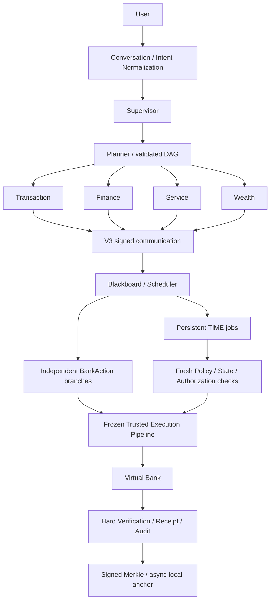
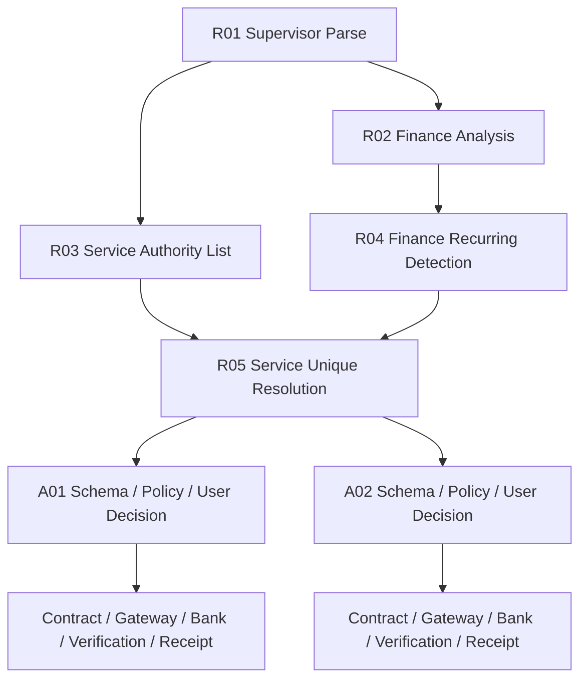

# TRUSTA Phase 5 — Full Banking Capability & Cross-Scenario Orchestration

2026-10-06。最终 **371项 / 480.245秒 / OK**；所需DoD A–N已满足。交付范围是六 Agent、六类银行场景与持久化 TIME 调度，运行对象为本地 Virtual Bank。编码前基线为 **285 项 / 204.365 秒 / OK**；最终验证汇总见 [机器记录](phase5-validation.json)。原始测试文件的 SHA-256 在实施前保存，交付时再次核对，不删除原断言。

## 1. Architecture Review

[编码前架构分析](phase5-architecture-review.md)记录实际工程差距、领域状态机、冻结边界和实施计划。现有 Gateway、权限、精确动作授权、银行原子事务、权威核验与 Phase 4 审计能容纳新业务，无需重选核心架构。保留原 TRANSFER IR 和历史签名材料；增加非转账 IR V2、领域表和 Runtime 分支。安全执行链继续为：

```text
BankActionIR → Schema Validation → Capability → Policy → Authorization
→ Execution Contract → Tool Gateway → Bank Adapter → Virtual Bank
→ Hard Verification → Receipt → Audit
```

## 2. 六场景 Gap Analysis

| 场景 | 实施前 | 本期结果 |
|---|---|---|
| 智能转账 | 姓名、API账户选择；无手机号/alias/TIME/AA | 增加手机号、alias、自然语言账户、持久化 TIME；AA 为整数分摊请求 |
| 账单分析 | 分类、自然月统计、异常提示 | 原结果保留；增加周期性扣费候选，供跨场景使用 |
| 理财 | 风险匹配与只读推荐 | 比较、确定性适当性、真实沙箱申购/赎回 |
| 卡片 | 无领域/执行方法；Service inactive | 四类管理写动作、权威卡片状态机 |
| 订阅/代扣 | 无权威资源 | 查询/检测/取消、查询/停用；候选不等于可取消资源 |
| 跨场景 | 三类固定串行图、单授权 | 并行读取、实际依赖、动态安全分支、逐项审批、TIME暂停/恢复 |

## 3. 最终 Multi-Agent Architecture

只激活既有 Service，活跃业务 Agent 恰好六个。Executor、Schema、Policy、Authorization、Verifier、Receipt 与 TIME worker 是确定性基础设施，均不是新 Agent。

| Agent | 输入/职责 | 输出与边界 |
|---|---|---|
| Supervisor | 非 Agent Intent/Conversation 层的结构化请求 | 创建任务/澄清；无银行写能力 |
| Planner | 任务类型 | 校验模板 DAG；每动作扩展固定安全分支 |
| Transaction | 当前客户账户、唯一收款人、余额 | TRANSFER提案，AA请求；不执行资金 |
| Finance | 权威消费与周期扣费历史 | 分类、分析、异常与订阅候选；只读 |
| Service | 权威Card/Subscription/DirectDebit | 唯一资源解析与管理提案；不执行状态修改 |
| Wealth | 权威风险、产品、现金/持仓 | 比较/推荐/投资提案；不决定适当性结果 |



新业务路径使用确定性句式与来源解析。已有模型无关平台保留，未将模型接入银行执行。新场景没有新增推理权限；Provider Evaluation Harness 独立接入既有 Provider Interface，不持有 Bank/Gateway 执行句柄。

## 4. 新增 Domain Model

附加十张表，不重写原 accounts/payees/transactions/actions/receipts/audit。金额为 CNY 整数分。

| 表 | 关键内容与状态 |
|---|---|
| payee_contacts | payee_id、phone、alias、ACTIVE/DISABLED；查询始终限制当前客户 |
| cards | customer/account、type、status、spending_limit、三类开关、created_at/version |
| subscriptions / direct_debits | merchant、customer/account、amount/currency、frequency、next_charge_at、status/cancelable/source/version |
| recurring_charges | 权威已结算历史扣费；用于周期识别，不重新扣减今日现金 |
| product_restrictions | 权威申购/赎回开关 |
| portfolio | customer/account/product复合键、amount_cents、redeemable_at、version |
| bank_operations | action/hash、客户、唯一idempotency_key、before/after/SETTLED |
| investment_transactions | operation、账户/产品、PURCHASE/REDEEM、金额、币种、状态/时间 |
| scheduled_jobs | task、TIME、索引时间/状态、完整任务体及完整性封印 |

Card：ACTIVE→FROZEN→ACTIVE；改限额/交易控制要求 ACTIVE。LOST/CANCELLED 不可解冻，本期没有挂失/销卡写接口。Subscription：ACTIVE→CANCELLED；DirectDebit：ACTIVE→DISABLED，均要求权威cancelable标记且不自动恢复。

## 5. Service Agent 设计

`agents/service.py` 只通过 Gateway 查询权威资源、核对候选并建立 IR。Finance 从同商户/金额/币种至少三笔、相邻间隔25–35天的已结算历史识别候选。Service 使用商户、账户、金额、币种、ACTIVE、cancelable 做唯一匹配；多匹配/无匹配为 UNRESOLVED，没有取消 IR。

“明显没必要”不会被当作确定业务事实或同意。系统展示候选与依据，由用户决定每一条订阅。未知商户仍出现在分析结果中，不能伪造银行订阅。

## 6. Wealth Execution 设计

产品比較和推荐保持只读。投资 Policy 与银行原子事务分别核对：权威风险档案及有效期、产品风险/active/minimum、现金、CNY、产品限制、持仓和持有期。R2买R4、过期风险档案、低于门槛或资金不足均阻断。

申购原子修改：客户现金减少、投资结算账户增加、Portfolio本金份额增加、投资交易与借贷账本落库；赎回反向修改。HardVerifier 独立读取操作、现金/资源/持仓、投资交易和两条对应账本，只有完全一致才出成功回执。

沙箱单位价格固定为1，以本金分模拟份额，不计算市场收益。对于有期限产品，新申购的可赎回时间从 **动作有效期上限 + term_days** 保守计算，保证不早于实际成交后的持有期；同一持仓聚合而非分批次，因此后续申购可能延长整个持仓等待期。零期限产品可即时赎回。生产批次、净值和适当性问卷不属于本期实现。

## 7. Scheduled / Trigger Runtime

实现 TIME，未实现 BANK_EVENT/BALANCE_THRESHOLD/TRANSACTION_EVENT。Job 保存 schedule_id、task_id、action_template、execute_at、timezone、status、created_by、authorization_binding、policy_snapshot、idempotency_key、action_id。时区显式 Asia/Shanghai；“下周五”缺少时刻时澄清。

```text
PENDING_AUTH → SCHEDULED → CHECKING → EXECUTING → COMPLETED
                               ↘ REAUTH_REQUIRED → 重新核对/逐项授权
EXECUTING/VERIFYING 中断、未知执行结果 → MANUAL_REVIEW
用户拒绝 → CANCELLED；已知银行回滚 → FAILED
```

Jobs 使用独立派生域的 HMAC 封印，数据库索引时间/状态必须匹配封印内字段。修改 body、索引时间、绑定或状态不能导致提前执行。检测到篡改进入人工核查，读取损坏 job 返回 SCHEDULE_TAMPERED。

领取到期Job使用SQLite事务；每次执行重查Schema、提案身份/权限、账户/余额/收款人、Policy、授权期限与认证等级、动作hash和精确binding，再签发短期Contract。金融TTL仍为动作900秒、授权300秒、Contract60秒，**不因长期调度延长**。到期失效或状态变化时，旧动作SUPERSEDED、新动作独立hash/授权；Job保持原幂等键，不自动批准。若资源已失效则BLOCKED。

工作器不通过等待后直接调用Bank。等待只决定何时检查数据库Job；写入仍走冻结链。不确定提交进入MANUAL_REVIEW，无自动重试。服务重启修复EXECUTING/VERIFYING；独立worker使用recover_workflows=False，不将仍运行的服务任务误当重启故障。部署约束是**单服务+一个TIME worker**，运行升级/恢复前停止全部旧进程；不声称分布式租约或集群安全。

## 8. Cross-scenario DAG



R02/R03由ThreadPoolExecutor真正并行读取，之后序列化保存结果和签名消息；R05必须等两条依赖完成。只给RESOLVED权威资源追加六步安全分支S/P/A/E/V/R，既有图扩展规则严格校验步骤/owner/dependency。金融写分支逐项执行，不并行竞争现金。

Blackboard保存Goal、DAG/steps、agent_results、candidates、action_records[]、proposed_actions[]、authorizations[]、verifications[]、receipts[]、audit_refs、scheduled_job_refs；GET任务还投影读取经验证的scheduled_jobs[]。Runtime/recovery独占这些新增金融集合更新。DAG节点包括WAITING_USER/WAITING_TIME/FAILED/BLOCKED/MANUAL_REVIEW，支持未执行动作refresh。批准A、拒绝B可以完成目标中的用户选择；COMPLETED不表示被拒动作也执行，必须读取每动作状态。

## 9. 新目录与代码修改列表

```text
backend/
  banking/{actions,extended_schema,extended_bank,intent}.py       新增
  agents/service.py                                            新增
  runtime/{banking,banking_plan}.py                             新增
scripts/{scheduled_worker,phase5_demo}.py                       新增
benchmarks/
  banking_cases.json / banking_task_benchmark.py                新增
  provider_cases.json / provider_evaluation.py                  新增
  banking_security_benchmark.py                                新增
tests/{test_phase5_banking,test_phase5_api,test_phase5_evaluation}.py 新增
docs/phase5-*                                                  分析、说明、原始结果
```

| 修改文件 | 目的 |
|---|---|
| config.py / .env.example | 本地默认Phase5/V3，历史Python配置保留 |
| persistence.py / business.py | 附加领域表与十二任务类型 |
| banking/virtual_bank.py / adapter.py | seed、客户范围phone/alias、资源读和原子写manifest |
| agents/registry.py / security/registry.py / capability.py | 六Agent配置与最小新增权限 |
| security/crypto_registry.py | 受控能力承诺升级、Service密钥、持久化banking版本下限 |
| agents/finance.py / wealth.py / planner.py | 周期候选、比较及投资提案、固定安全图分支生成 |
| schema_validator.py / policy.py / verification.py | 新IR严格校验、确定性规则、权威复核 |
| execution/contract.py / gateway.py | 精确cap绑定、提案身份复查、受控新Adapter动作 |
| runtime/blackboard.py / scheduler.py / message_bus.py | 多动作集合、图扩展、TIME状态和事件 |
| service.py / conversation/service.py / server.py | 新场景编排、多轮补全、逐项API、原转账即时风险重查 |
| scripts/audit_worker.py / manage_crypto_identity.py | 六Agent配置与Service运维 |
| benchmarks/security_benchmark.py | 原18攻击不删，新增banking_version=5运行参数 |
| README.md / docs/api.md | 当前阶段、运行与接口说明 |

没有新trusted/大模块；没有新Card/Subscription/CrossScenario等Agent；原19个测试文件保持字节一致。原回执结构、旧IR哈希、签名根、历史公钥/撤销状态、审计链/Merkle协议保持兼容。

## 10. Capability 变化

Service：account/card/subscription/direct_debit只读与service.propose。Wealth新增account/balance/portfolio只读与wealth.propose；Finance仍只有account/transaction读取。Transaction沿用transfer.propose。Executor独占九个银行写capability，所有六Agent直接尝试Gateway写均拒绝。

Schema/Policy/Verifier按职责获得新增资源与操作证据读取，不获得写权限。V3的capability commitment按实例Registry更新，旧profile不会静默获得新权限。Suspend/revoke后的提案者在Runtime与Gateway复查，不能继续执行旧提案。

## 11. BankActionIR 动作类型

| 动作 | initiating_agent | capability / tool |
|---|---|---|
| TRANSFER（原IR） | transaction | banking.transfer / transfer.create |
| CARD_FREEZE / CARD_UNFREEZE | service | banking.card.freeze/unfreeze / card.freeze/unfreeze |
| CARD_LIMIT_CHANGE | service | banking.card.limit / card.limit_change |
| CARD_TRANSACTION_CONTROL | service | banking.card.control / card.transaction_control |
| SUBSCRIPTION_CANCEL | service | banking.subscription.cancel / subscription.cancel |
| DIRECT_DEBIT_DISABLE | service | banking.direct_debit.disable / direct_debit.disable |
| INVESTMENT_PURCHASE / INVESTMENT_REDEEM | wealth | banking.investment.purchase/redeem / investment.purchase/redeem |

非转账IR为闭合dataclass：schema_version=2、target{kind,id}、parameters、权威preconditions/expected_postconditions、客户/账户、原因/证据、期限/幂等键。额外字段、金额bool、类型不匹配、未知资源或非法owner/cap均拒绝；canonical hash区分bool和整数。纯分析、比较、检测与AA不生成资金IR。

## 12. Policy / Authorization 变化

所有写都需明确单动作授权。卡解冻、限额提高、重新开启交易权限、高额投资需STRONG_AUTH；口令是沙箱示例，不是生产MFA。投资适当性和资源状态为确定性规则。银行事务再次核验批准前置状态，堵住Policy到提交间的状态竞争。

授权绑定客户+动作hash；Contract另绑定action_id/capability/idempotency/preconditions、Policy和授权ID。原即时转账在Phase5也重查Policy；风险等级提高先返回新的强化授权，不复用原普通确认。TIME每次到期重查当前风险。聊天“我确认”不代替专用API。

API提供逐动作批准/拒绝，没有approve_all。Benchmark中的循环助手仅依次模拟多个独立用户决定，调用不同动作ID/hash/授权，不是共享审批。refresh只允许未执行且确定安全的动作；MANUAL_REVIEW不能用refresh重发。

## 13. 六场景 Demo 与运行

```powershell
python -m scripts.phase5_demo --output docs/phase5-demo.json
```

实际HTTP请求、银行状态、逐项授权、DAG、回执证明和重启结果见 [Demo原始记录](phase5-demo.json)。每场景独立数据库，避免前一场景扣款污染后一场景期望值；不修改日常data/trusta.sqlite3。

| Demo | 实际结果（整数分） |
|---|---|
| 1 手机号转账2000元 | payee-zhang；现金1000000→800000，1笔SETTLED |
| 2 分析2026-09消费 | net_spend=542500、异常3；现金/银行操作不变 |
| 3 推荐/比较+买1000元、赎400元 | 推荐/比较只读；现金1000000→900000→940000，持仓60000，2投资交易/4账本 |
| 4 卡管理 | ACTIVE→FROZEN→ACTIVE；限额100000，三开关关闭，4银行操作 |
| 5 订阅/代扣 | sub-stream=CANCELLED；dd-electric=DISABLED，现金不变 |
| 6 跨场景 | 真实并行/依赖图；批准一项、拒绝一项，1取消/1保留，未知候选UNRESOLVED |
| 附加TIME | 到期前重启，实际到期执行100元；现金990000，重复tick不新增交易 |

六场景与TIME合计11份成功回执，均通过signed Merkle及固定测试公钥验证、重启后再验证；本地anchor验证不等于外部区块链证明。

日常运行：先停止旧进程并备份数据库、signing.key、api.token与加密.keys目录；正常Config.local默认banking_version=5、V3。原Phase4五主体能力承诺只有精确匹配已知旧配置才升级，保留既有密钥/身份状态，再增加Service并封印minimum_banking_version=5。升级后不能回降；不可使用替换根密钥“修复”。没有对日常数据库进行重置或Demo扣款。

```powershell
.\start.ps1
# 服务启动完成后，在另一终端启动TIME worker：
python -m scripts.scheduled_worker --watch
```

start.ps1已有独立审计worker；TIME worker独立启动并随运维一起停止。强授权需设置TRUSTA_STRONG_AUTH_SECRET。旧Web UI仍以原三个场景为主，新场景通过API/Demo验收，本期没有完成六场景展示UI。

## 14. Banking Task Benchmark

```powershell
python -m benchmarks.banking_task_benchmark --output docs/phase5-banking-benchmark.json
```

34个手工标注案例，不用被测实现生成期望标签。涵盖正常/强风险、缺字段、模糊收款人、多轮补全、卡终态、产品风险/最低金额/现金/持有期、部分拒绝跨场景、AA、到期TIME/过期暂停、非法自动确认、模型虚构卡字段。每个案例实际创建独立SQLite银行，记录原请求、expected、actual、检查项、失败原因和耗时；[JSON](phase5-banking-benchmark.json)与[CSV](phase5-banking-benchmark.csv)均可复核。

模型幻觉案例单独调用候选guard验证拒绝，银行场景始终依据原始用户请求和权威读取执行；不声称此案例使用了真实模型。TIME使用真实本地时钟、持久化Job与worker检查；过期条件为显式隔离故障注入。

## 15. Benchmark 实际结果与 Provider Harness

Banking Task首轮最终数据集观察：case_pass 34/34、完成任务23/23、意图34/34、参数11/11、澄清/图/工具/授权/终态各34/34、跨场景2/2。完成率分母只包含期望COMPLETED的案例；安全阻断/澄清不伪计完成。小型合成数据集的100%不能外推开放自然语言准确率或生产可靠性。

```powershell
python -m benchmarks.provider_evaluation --output docs/phase5-provider-evaluation.json
# 凭据存在时，通过已有配置选择任意Provider：
python -m benchmarks.provider_evaluation --llm-config config/llm.toml --provider YOUR_PROVIDER --output docs/provider-live-evaluation.json
```

Provider Harness支持现有mapped HTTP、OpenAI-compatible Chat Completions及Python注入ProviderProtocol实现。模型名/endpoint/字段映射在配置中，密钥仅环境变量。Router先做配置/数据敏感度/复杂度约束，选定Provider可替换，不改Agent或金融链。

15例覆盖意图、参数、澄清、模糊转账、多意图、账单、卡、订阅/代扣、理财、跨场景、虚构字段。闭合schema与来源guard拒绝银行ID/风险/授权捏造。默认[JSON](phase5-provider-evaluation.json)/[CSV](phase5-provider-evaluation.csv)明确OFFLINE_FIXTURES：15/15 guard与预期一致，意图/澄清/计划15/15，参数13/15，两个故意恶意样本保留错误原输出且被拒绝，未掩盖成参数成功。

未调用有凭据的外部真实模型，real_model_experiment_verified=false。测试中的两种实际HTTP协议服务器也明确为fixture，不能算真实模型实验。来源guard保守限制到明确句式；高自由度语义理解仍属下一阶段。

## 16. Security Benchmark 回归

原18攻击种类/原断言保持，默认旧profile4；增加--banking-version 5参数，使相同攻击也在六Agent/V3下运行：

```powershell
python -m benchmarks.security_benchmark --output docs/phase5-phase4-security-regression.json
python -m benchmarks.security_benchmark --banking-version 5 --output docs/phase5-security-benchmark.json
python -m benchmarks.banking_security_benchmark --output docs/phase5-banking-security.json
```

两个原安全基准各5轮/90次攻击，全部检测，未授权执行0/15、有效消息/证明误拒绝0/135。覆盖伪造、篡改、重放、旧/撤销密钥、权限提升、hash不匹配、重复执行、审计/Merkle/checkpoint/anchor篡改及算法降级。原Phase4报告未覆盖删除，新运行保存在单独报告。

新增业务安全基准3轮/45观察：六Agent直接卡写、Wealth直写、缺合约、订阅target交换、虚构风险参数、共享跨动作授权、暂停提案者、卡幂等、TIME过期及提前索引篡改。45/45阻断或满足幂等控制，未授权银行状态改变0/45；检查全部账户、卡、订阅、代扣、持仓、银行操作、投资交易、原转账与账本的指纹。见 [业务安全JSON](phase5-banking-security.json)/[CSV](phase5-banking-security.csv)。这是受控沙箱攻击观察，不是生产渗透测试或概率保证。

## 17. 全量测试结果

```powershell
python -m unittest discover -s tests -v
```

最终全量 **371项 / 480.245秒 / OK**，含原285项、53个新测试及33项继承的Phase5转账验收。原19个测试文件字节完全一致；数量/耗时、SHA一致性、报告通过状态在 [phase5-validation.json](phase5-validation.json) 和 [全量日志](phase5-tests.txt)。本次最终结果均已通过。

保留原285测试与所有断言；其中历史五Agent/Wealth只读等断言仍在明确旧profile下验证兼容。同时继承原33项转账验收在Phase5/V3再次执行，原账单542500与推荐r1/r2在Phase5单独核对。新增领域、TIME、授权隔离、幂等、重启、Crypto迁移、HTTP与Provider/六Demo检查。不能把历史五身份断言描述成六身份断言。

## 18. 已知限制

- Virtual Bank为沙箱；Card/订阅/代扣只改变银行域记录，没有真实卡网络、商户解约或后续扣款引擎。
- 投资为本金/固定单位价模拟，没有市场行情、收益承诺、税费或生产合规适当性。
- AA只生成整数分摊请求，未实现外部催款、代付款或收款清算。
- 新场景句式有限，模糊多目标安全澄清；未实现任意自然语言自动生成任意DAG。跨场景模板为账单→订阅管理与TIME转账，非通用工作流语言。
- 单机SQLite、单服务/单TIME worker；任务/银行跨事务故障需人工核查，无跨节点租约、恰好一次消息或并行金融写保证。
- 风险/余额/资源始终来自银行；Memory不保存这些快照作决策，不保存授权；未新增模型事实通道。
- 密钥共址和全历史审计核验规模风险沿用Phase4；Local Anchor不是外部可信链。DID、真实Blockchain/ZKP/KMS/HSM仍未实现，接口保留。
- 新六场景Web UI、真实LLM实测、真实银行和移动端未实现。本期未重点投入这些内容。

## 19. 能力矩阵与Definition of Done

| 能力 | 状态 | 范围 |
|---|---|---|
| 六Agent / Service激活 / V3身份 | IMPLEMENTED | 正常Phase5配置，禁止降级 |
| 姓名/手机号/alias/明确账户 | IMPLEMENTED | 当前客户已登记唯一收款人 |
| TIME持久化/到期重查/重新授权 | IMPLEMENTED | 单机独立worker，未实现事件触发 |
| AA | PARTIAL | 分摊请求完成，外部收款未实现 |
| 账单分类/月度/异常/周期候选 | IMPLEMENTED | 确定性分析/提示，不是欺诈认定 |
| 比较/推荐/适当性/申购/赎回 | IMPLEMENTED | 本金单位价沙箱；生产投资仍未实现 |
| 卡四动作/终态保护 | IMPLEMENTED | 挂失/销卡业务 NOT IMPLEMENTED |
| 订阅list/detect/cancel、代扣list/disable | IMPLEMENTED | 权威状态管理，商户网络 NOT IMPLEMENTED |
| 并行依赖DAG/多动作独立审批/恢复 | IMPLEMENTED | 固定模板，任意组合计划 PARTIAL |
| Model-agnostic Provider Harness | IMPLEMENTED | offline CI及HTTP协议；真实模型实测 NOT IMPLEMENTED |
| Banking/Security Benchmarks/JSON+CSV | IMPLEMENTED | 受控独立沙箱数据 |
| ECDSA/Merkle/Local Anchor | IMPLEMENTED | 外部链/DID/ZKP NOT IMPLEMENTED |
| 六场景Web展示/生产银行/生产KMS | NOT IMPLEMENTED | Phase6/后续集成 |

DoD A–N逐项证据：A六HTTP场景；B六Registry/V3身份；C卡状态；D订阅终态；E投资现金/持仓/交易/账本；F并行和依赖图；G真实TIME与过期/状态/风险测试；H逐项批准/拒绝；I冻结链及直接Agent拒绝；J原285+Phase5继承转账/只读核对；K原18类两配置安全基准；L可重复34任务Benchmark；M全量日志；N报告始终标明sandbox/fixture/offline。最终验证文件全部通过，本期沙箱范围的DoD已满足。

## 20. Phase 6 建议

优先围绕现有API完成六场景展示：来源依据、实际DAG、逐项授权、TIME重新核对、人工核查与签名回执。展示不引入金融旁路。随后使用相同数据集接入两种有授权凭据的Provider，独立报告原输出/拒绝率/成本/延时，扩充自然语言与跨月样本；生产化再处理外部身份/密钥隔离、工作器租约、投资批次与外部银行适配。DID/Blockchain/ZKP按明确用例逐步验证，不作为比赛主线堆叠。
