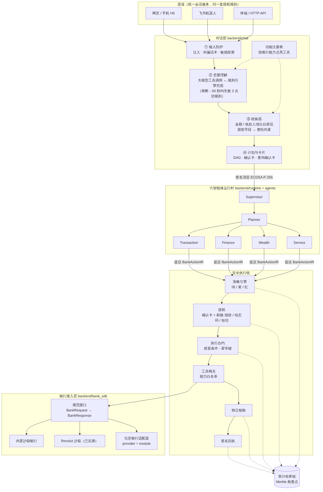
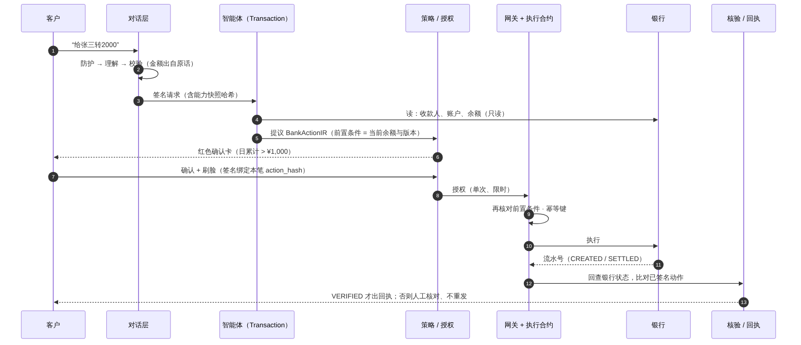
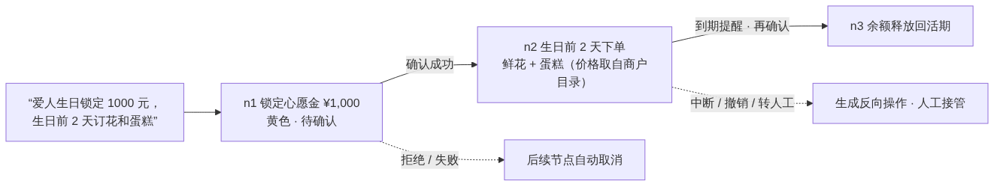

# TRUSTA 技术文档

本文是参赛作品的技术文档，内容包括：
- 系统架构图；
- 核心算法说明；
- 安全设计。

所有内容对应当前代码，括号中注明实现位置和测试。

延伸阅读（当前版本以本文为准）：
- 早期设计记录：`docs/architecture.md`（V1 历史版本）；
- 银行接入：[接入真实银行](real-bank-integration.md)、[数据格式规范](bank-data-contract.md)、[银行安全审查说明](bank-security-brief.md)；
- 多智能体签名通信与跨机构协作：README 图 1、图 2。

---

## 1. 系统概述

TRUSTA 是一个银行 AI 智能体。客户用自然语言提出需求，系统负责理解意图、规划任务，并在严格的安全框架内办理银行业务。

核心原则只有一句话：**AI 只能提议，不能授权。** 模型的输出只是"建议调用哪个工具、参数是什么"。

除此之外，每一步都由确定性的代码负责：
- 校验这个建议能否成立；
- 判断风险等级；
- 取得客户本人授权；
- 在银行执行；
- 回查并独立核验；
- 出具回执并写入审计。

| 赛题场景 | 实现情况 |
|---|---|
| 智能转账 | 按姓名、手机号、称呼转账，可加备注；支持定时和周期转账；支持 AA 分摊收款 |
| 账单分析 | 消费分类统计、月度和年度报告、异常交易识别、与上一期对比 |
| 理财操作 | 产品推荐与对比、风险测评、申购与赎回、持仓查询，以及按消费情况给出资产配置建议 |
| 卡片管理 | 虚拟卡申请、冻结与解冻、挂失与解除挂失、调整限额、交易开关、重置密码 |
| 订阅与代扣 | 自动识别周期扣费、续费提醒、取消订阅、关闭代扣 |
| 跨场景联动 | 例如"爱人生日锁定 1000 元，生日前 2 天订花和蛋糕"；还有出行管家、"当……就……"联动规则 |
| 扩展业务 | 定期存款、外币兑换、黄金与定投、基金份额、贷款与分期、信用账单 |

接入渠道包括网页、手机 H5、飞书机器人、终端命令行和 HTTP API。所有渠道共用同一套会话服务和授权规则。

## 2. 系统架构

**图 1 总体架构。** 请求自上而下经过四层，每一层只拥有自己需要的权限：

1. **对话层**（`backend/chat`）：
   - 输入防护：识别提示注入、诈骗话术、信息套取；
   - 意图理解：调用大模型的工具调用能力；模型不可用时自动降级到规则引擎；
   - 校验器：检查模型给出的参数能否成立；
   - 计划与卡片：生成任务计划和确认卡。

   功能注册表根据接入银行实际提供的能力，决定哪些工具可以交给模型使用。

2. **六智能体运行时**（`backend/runtime`、`backend/agents`）：
   - Supervisor 负责接收和监督，Planner 负责拆解任务；
   - Transaction（转账）、Finance（账务分析）、Wealth（理财）、Service（卡片与订阅等服务）各管一类业务；
   - 智能体之间的每条消息都用 ECDSA P-256 签名，并做防重放检查。

3. **安全执行链**：策略引擎 → 授权 → 执行合约 → 工具网关 → 独立核验 → 签名回执。智能体只能提出操作（BankActionIR），不能执行。

4. **银行接入层**（`backend/bank_sdk`）：统一的规范接口。可以接内置沙箱银行、Revolut 官方沙箱（已实测），也可以通过适配器接任意银行。

所有关键事件都写入审计哈希链，并定期生成签名的 Merkle 检查点。

**图 2 一笔红色转账的完整写路径。** 关键点有四个：
- 前置条件（当时的余额和账户版本）在提议时就被写进动作；
- 客户的刷脸或指纹签名只对这一笔的 `action_hash` 有效；
- 执行前会再次核对前置条件，同一个幂等键只执行一次；
- 只有银行状态与已签名动作逐项一致，才会出回执。

## 3. 核心算法

### 3.1 意图理解：工具调用 + 原话锚定 + 规则兜底

1. **模型只能调用工具**（`backend/chat/llm.py`、`tools.py`）。系统提示词里只给出资源的编号和显示名，不包含余额和交易流水。模型输出的数字不会直接展示给客户（`service.py` 中"模型自由文本含数字不渲染"）。

2. **原话锚定**（`backend/chat/amounts.py`、`validator.py`）。金额、收款人、期限、币种等关键参数，都必须能在客户原话里找到对应片段（span），并做一致性校验。例如"两千块"必须解析为 200000 分。找不到就向客户追问，不会去猜。

3. **省略上下文与多轮补全**。系统记住上一轮缺了哪一项。比如先说"给张三转账"，再说"两千"，两轮会合并成一笔完整的转账。"改成 800"会替换掉上一张确认卡。

4. **隐含意图**。"卡好像被盗刷了"会映射为冻结，"卡丢了"会映射为挂失，直接生成对应的确认卡，不在聊天里反复询问。

5. **规则兜底与熔断**。模型 60 秒内失败 3 次，就熔断 120 秒，期间使用规则引擎（`rules.py`）。规则引擎只识别标准说法，同样经过上面的校验器。

6. **多意图拆解**。一句话里包含多个意图时，会拆成有序的计划节点，前端显示为任务图。

### 3.2 任务规划：有向无环图（DAG）与执行控制

**图 3 跨场景任务图。**
- 复杂任务会拆成有依赖关系的节点（`backend/runtime/taskgraph.py`、`graph_runtime.py`、`event_plans.py`）。
- 一轮对话里有多笔动钱的操作时，这些写操作**串行**执行：后一张确认卡要等前一笔执行后，按最新的账户状态生成；前一笔被拒绝，后续节点自动取消。
- **中断**："算了不转了"会取消所有待确认的操作。
- **回退**："撤销刚才的"会生成反向操作，再由客户确认。
- **人工接管**："转人工"会打开工单，由运营人员回复。

### 3.3 权限分级

代码见 `backend/policy.py`、`backend/security/banking_controls.py`、`permission_matrix.py`。

| 级别 | 执行策略 | 判定规则 |
|---|---|---|
| 绿色 | 自动执行 | 只读查询：余额、交易、账单分析、理财收益与持仓 |
| 黄色 | 用户确认 | 小额转账（当日累计 ≤ ¥1,000）、**订阅与代扣查询**、取消订阅、虚拟卡申请、冻结卡等。订阅查询先显示一张查询确认卡，确认后 10 分钟内不重复确认 |
| 红色 | 强验证 | 当日累计 > ¥1,000、外币转账、单笔达到大额阈值、10 分钟内第 4 笔转账、向 24 小时内新加的收款人转 ≥ ¥500、修改密码、挂失与解除挂失、解冻、调高限额、理财申购与赎回、添加收款人 |

**风险升级**由 `safety.risk()` 计算：当日累计按北京时间自然日统计 TRUSTA 发起的转账，再叠加转账频率、新收款人、外币三类条件。

**强验证**可以用三种方式完成：
- 刷脸、指纹、安全密钥（WebAuthn，`backend/security/webauthn.py`）。签名的挑战值是 HMAC(密钥, 授权编号 + 动作哈希)，所以只对这一笔有效。必须是本人验证（UV），只碰一下（UP）不算。签名计数器不能回退，防止克隆密钥或重放。
- 认证器动态码（TOTP）；
- 短信验证码：5 分钟有效，最多 3 次，绑定这一笔授权。

权限表与运行时的一致性由 `tests/test_permission_matrix.py` 校验：用真实对话逐级检查。

### 3.4 执行合约与独立核验

- **BankActionIR**（`backend/banking/actions.py`）包含：动作类型、目标、参数、前置条件（快照）、预期后置条件、过期时间、幂等键。预期后置条件由确定性规则 `expected_state` 根据前置条件计算出来，不依赖模型。
- **执行前**：
  - 校验结构；
  - 核对授权与动作哈希一致；
  - 重新读取前置条件，与快照比对；
  - 确认网关的能力白名单包含这个工具。
- **执行后**（`backend/verification.py`）：
  - 回查银行的操作记录和当前状态，必须与签名动作、预期后置条件逐项一致；
  - 沙箱银行还会核对记账分录，保证借贷平衡；
  - 外部银行由适配器的 `verify()` 给出核验结果；
  - 不一致或无法确认时，进入人工核对，**不会自动重发**。

### 3.5 订阅识别

代码见 `backend/agents/finance.py` 的 `recurring`、`backend/chat/pages.py`。

1. 取近 6 个月已入账的消费。银行若提供周期扣费数据，优先使用。
2. 按（商户, 金额, 币种）分组，同组至少扣过 3 次，且每两次间隔都在 25–35 天，就判定为疑似订阅。
3. 用间隔的中位数推算下次扣费日。
4. 银行已登记为订阅或代扣的商户不重复提示。客户可以选择"是我的订阅"、"忽略"或"不认识这笔"；选"不认识这笔"会给出止损办法。
5. 客户也可以直接说"QQ音乐是我每月续订的"，系统把它登记为订阅，但不会替客户去订。

### 3.6 异常交易识别

代码见 `FinanceAgent.anomalies`。以下三条规则任一命中即标记，并在结果中附上命中的规则：
- 单笔金额 ≥ 大额阈值（默认 ¥1,000）；
- 当月消费笔数不少于 5 笔，且这笔金额超过当月中位数的 10 倍；
- 同一商户、同一金额、同一币种，5 分钟内重复出现，提示可能是重复扣款。

### 3.7 理财配置建议

代码见 `WealthPage.plan`，是确定性计算：
1. **备用金**：取近三个月平均消费加上每月固定扣费，乘以 3 留作备用金。
2. **分配比例**：剩余资金按风险等级分配（固定表）：
   - R1–R2：100% 稳健；
   - R3：稳健 70%、增强 30%；
   - R4：稳健 50%、增强 30%、进取 20%；
   - R5：稳健 40%、增强 30%、进取 30%。
3. **选产品**：从银行在售且风险等级不高于客户测评结果的产品中挑选，尽量来自不同发行机构。
4. **约束**：不推荐个股，不承诺收益，每个数字都注明来自哪些银行记录。

### 3.8 输入防护与不可信数据隔离

代码见 `backend/chat/guard.py`、`backend/banking/transaction_feed.py`。

- **会话内拦截**：识别到提示注入、诈骗话术或信息套取时，本轮不生成任何资金操作。同一会话累计 3 次注入，锁定 10 分钟，并取消所有待确认操作。
- **模型输出检查**：模型的工具调用里出现授权类字段（approve、risk_level、otp 等），整轮作废，按注入处理。
- **他人文字隔离**：转账备注、付款人、商户名都是别人写的。入库时就做分类，看起来像指令的只保存哈希，界面上只显示占位符，这些文字从不发给模型。

## 4. 安全设计

| 赛题要求 | 设计 | 实现与测试 |
|---|---|---|
| 权限分级 | 三级分类与升级规则，见 3.3 | `policy.py`、`banking_controls.py`；`tests/test_permission_matrix.py`、`test_webauthn.py` |
| 幻觉防护 | 业务数字只来自银行接口；关键参数必须出自原话；模型含数字的文字不展示；结果以银行回查为准 | `validator.py`、`amounts.py`、`service.py`；`tests/test_chat.py` |
| 注入防御 | 输入防护、模型输出授权字段检测、他人文字隔离、累计 3 次锁定会话 | `guard.py`；`tests/test_chat.py`、`benchmarks/security_benchmark` |
| 操作审计 | 每轮对话的决策链（原话哈希 → 工具调用 → 校验结论 → 卡片 → 授权 → 执行 → 核验）都可以查看；审计用哈希链串接，定期生成签名的 Merkle 检查点 | `backend/audit.py`、`audit_trust/`；`service.trace()` |
| 异常熔断 | 连续认证失败 5 次或执行失败 3 次，锁定账户的写操作；模型接口熔断；客户可以一键开启 24 小时转账冷静期 | `banking_controls.py`、`service.py` |
| 沙箱环境 | 见下 | `finance_transport.py`、`windows_container.py`、`schema_validator.py` |

**关于"沙箱环境"：** TRUSTA **从不执行模型生成的代码**。模型只能输出结构化的工具调用，参数要先经过 JSON Schema 和业务规则校验，任务计划也要先经过计划校验器（`plan_validator.py`）才会运行。对话层与渠道代码（接触模型输出和外部输入的部分）里没有 `eval`、`exec`、`compile`，也不引入 subprocess、pickle，由测试 `tests/test_enhancements.py::test_no_dynamic_code_execution` 静态检查。唯一启动的子进程是下面的受限财务进程：启动命令固定，不接受模型的任何输入。

在此基础上，还有三层隔离：
- 财务智能体可以放在独立的受限进程里运行（`TRUSTA_FINANCE_PROCESS_ENABLED`）。它只能使用只读工具白名单，也无法选择签名密钥。
- 智能体源码中禁止访问数据库、银行适配器和执行接口，由测试 `test_agent_source_has_no_database_adapter_or_execute_calls` 检查。
- 内置沙箱银行把所有资金操作限制在演示数据里；接入外部银行时，默认关闭写入，并有白名单和单笔上限。

**部署安全：**
- 默认只监听本机；
- 手机需要一次性配对码，每台设备单独发令牌，可以吊销；
- 密钥与数据库文件只有本人可读；
- 大模型可以换成银行内部部署的模型，也可以完全不用；
- 详见 [银行安全审查说明](bank-security-brief.md)。

## 5. 部署与测试

- **Windows**：在 Releases 下载 `TRUSTA-windows-x64.zip`，解压后双击 `TRUSTA.cmd`，然后打开窗口里打印的 `http://localhost:8000/#token=…`。请用 localhost 打开，刷脸和指纹验证不支持 IP 地址。
- **源码运行**：`pip install -r requirements.txt` 后运行 `python -m backend.server`。配置向导：`python -m scripts.setup`。
- **测试**：`python -m pytest -q`。少数测试需要未随仓库发布的原始材料，缺少时显示为"跳过"并写明原因。另有六大场景闭环检查 `python -m benchmarks.scenario_audit`，以及攻击基准 `python -m benchmarks.security_benchmark --banking-version 5`。
- **接入真实银行**：`python -m scripts.bank_check --config <你的配置>`，见 [接入真实银行](real-bank-integration.md)。

图的源文件在 `docs/figures/tech/*.mmd`，可以用 `mmdc -i x.mmd -o x.png` 重新生成。
