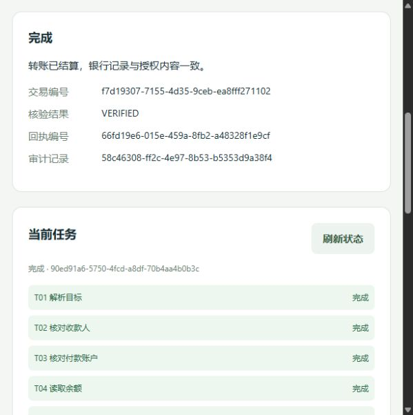

# 本地验证记录

当前最新：Phase 4 全量 **285 项 / 207.554 秒 / OK**，原 151 项保留，新增 134 项；独立安全基准 **18 类 / 90 次**全部检测或阻止，合法消息 / proof 误拒绝 **0 / 135**，未授权银行写入 **0 / 15**。详见 [完整 Phase 4 交付](phase4-cryptographic-trust.md)、[测试输出](phase4-tests.txt)、[机器验证摘要](phase4-validation.json) 和 [基准实测](phase4-security-benchmark.json)。本文后面的 Phase 1–3 数字为历史记录。

Phase 2 全量回归：59项测试通过，三个实际HTTP场景和浏览器交互通过；详见 [场景扩展验证](phase2-scenarios.md)。下文保留V1阶段验证记录。

验证日期：2026-10-05（Asia/Shanghai）。环境：Windows、Python 3.13.1、Node 24.14.0。

## 自动化

`python -m unittest discover -s tests -v`：38 项通过。规格 §29 的 20 项验收对应 `tests/test_acceptance.py` 中 `test_01` 至 `test_20`，其余测试补充强认证、拒绝授权、陈旧前置条件、重启中断、合约篡改及过期、银行事务内截止时间复核、提交成功后响应丢失、金额精度、调用路径和 HTTP 身份/来源检查。

关键成功测试运行真实 SQLite Virtual Bank，没有 always-success bank mock。故障注入仅用于读超时或真实提交后响应丢失；银行已知失败测试使用冻结账户状态变化。

`node --check frontend/app.js`：通过。

## 实际 HTTP 转账

`python -m scripts.demo` 的最终运行结果：

| 项目 | 结果 |
|---|---|
| Task | COMPLETED |
| Transfer | SETTLED |
| 转账金额 | 2000.00 元 |
| 原余额 → 当前余额 | 10000.00 → 8000.00 元 |
| Ledger DEBIT / CREDIT | 各 200000 分 |
| Hard Verification | VERIFIED |
| Receipt | 已持久化 |
| Audit Chain | VALID |
| 服务重建后回执 | 保留且一致 |

最后一次独立 HTTP 演示的任务为 `f71bd536-af5d-4355-8736-16fcf2e1cb6c`，银行交易为 `6f1dbe2c-fd2b-401f-86ad-8007b183ed7f`。演示使用隔离临时数据库，与日常演示数据分离。

## 浏览器交互

验证了创建请求、授权卡的收款人/金额/账户显示、点击确认、余额变化、成功回执、DAG 完成及页面刷新后的任务恢复。使用独立 `data/ui-check.sqlite3`，没有改变默认演示数据库。

## 边界

上述结果证明当前确定性本地沙箱路径及列出的失败分支，不证明生产银行、外部 LLM、生产认证或跨进程密钥隔离已经完成。详见 `assumptions.md`。
## Phase 3.1 验证（2026-10-05）

最终 `python -m unittest discover -s tests -v`：**92 项全部通过**，耗时 59.203 秒。保留原 59 项回归，新增 33 项推理接入测试。本文其他 V1 数字为历史阶段记录。

新增覆盖：默认关闭、Agent 用途权限、所有者隔离、数据分类、成本 / 上下文 / 安全 / 复杂度 / 延迟路由、严格输出与证据引用、重复调用、受约束回退、超时、调用元数据脱敏、锁外等待、任务版本比较、丢弃候选禁止再次提交、旧任务兼容、验证后写入 Agent 结果与合法通信方向。

Provider 测试使用实际本地 HTTP 协议服务器，覆盖 Chat Completions、原生字段映射、环境密钥、缺失密钥、拒绝、工具调用、截断、429、重定向禁止、响应大小与 Content-Type。未调用真实模型服务。

`python -m compileall -q backend scripts tests`：通过。

`python -m scripts.phase3_demo --output docs/phase3.1-demo.json`：通过，见 [结果](phase3.1-demo.json)。隔离持久化 Virtual Bank、真实 HTTP 银行业务、明确标注的离线推理样例：

| 检查 | 结果 |
|---|---|
| 转账 | COMPLETED / VERIFIED；余额 800000 分 |
| 模型配置切换 | offline-a → offline-b；待审批动作哈希不变 |
| 交易与账本 | 一笔交易；借贷各 200000 分 |
| 消费分析 | COMPLETED；2026-09 净支出 542500 分 |
| 理财推荐 | COMPLETED；R2 匹配 sandbox-r1 / sandbox-r2 |
| 影子调用 | 四次完成；候选无业务权限 |
| 只读场景 | 银行余额不变 |
| 重启与审计 | 三任务及结果保留；审计链有效 |

验证证明协议、接入边界与现有业务兼容，不证明真实模型理解质量、供应商部署 SLA、数据条款或生产身份隔离。后续范围见 [Phase 3.1 文档](phase3-model-agnostic-platform.md)。

## Phase 3.2 验证（2026-10-05）

`python -m unittest discover -s tests -v`：**118 项全部通过，66.946 秒**。原 92 项与新 20 项会话测试、6 项 HTTP 测试共同通过。覆盖多轮来源校验、中文金额、幻觉拒绝、拒绝 / 修改旧动作、聊天确认不授权、计划校验、权限 / 归属 / 版本 / 期限、幂等重复与并发迟到、模型不可用保守处理、说明事实及重启恢复。

`node --check frontend/app.js` 与 `python -m compileall -q backend scripts tests` 通过；浏览器没有记录到页面 JavaScript 错误。

`python -m scripts.phase3_conversation_demo --output docs/phase3.2-demo.json`：通过。实际 HTTP + 独立持久化 Virtual Bank，离线推理样例；旧授权拒绝，2500 元新授权结算为 VERIFIED；余额 750000 分，一笔交易。账单净支出 542500 分，理财 R2 匹配两项真实沙箱产品。审计有效、只读余额不变、会话与回执重建后保留。详见 [结果](phase3.2-demo.json)。

浏览器在独立临时数据库验证澄清、中文补充、聊天确认不扣款、金额修改新动作哈希、原请求 CANCELLED、新授权完成、VERIFIED 回执和刷新恢复；另验证账单月份补充与理财有据说明。日常演示银行数据未改变。截图见 [Phase 3.2](phase3.2-conversation.md)。

上述验证不证明真实模型理解质量；未发送真实密钥或客户数据至外部服务。长期 Memory 和可信通信增强仍为 Phase 3.3 范围。

## Phase 3.3 验证（2026-10-05～2026-10-06）

2026-10-06 最终 `python -m unittest discover -s tests -q`：**151 项全部通过，85.339 秒**，进程退出码为 0。原 118 项回归与新增 33 项共同通过：10 项 Memory、15 项通信、7 项 HTTP API、1 项三个业务场景完整演示。此结果包含最终共享锁与消息接受锁调整。

覆盖明确同意 / TTL / 白名单、跨用户删除拒绝、过期清理、引用不复制原文或风险数值、银行档案重新读取、推理期间撤回、统计 / 产品筛选不变、转账字段不从 Memory 补齐；V2 篡改与未知算法、陈旧任务 / 引用、重启防重放、旧版本宽限 / 撤销、V1 有界迁移及禁止降级、并发轮换、根密钥不匹配拒绝、原执行合约保留、五身份与各类权限一致性、未来扩展拒绝。

`node --check frontend/app.js`、`python -m compileall -q backend scripts tests` 通过。

`python -m scripts.phase3_security_demo --output docs/phase3.3-demo.json`：通过。隔离 Virtual Bank + 实际 HTTP + 离线模型样例：消息版本轮换至 2 并撤销 1 后，原动作哈希授权成功，2000 元转账 VERIFIED，一笔交易，余额 800000 分。消费净支出 542500 分、R2 两项理财产品筛选保持不变；详细说明只增加已有规则 / 产品库事实。Memory 首先 3 项重建保留，随后忘记偏好影响新说明，清空至 0 项，审计有效、回执一致、只读场景余额不变。见 [结果](phase3.3-demo.json)。

浏览器在独立临时银行、模型 disabled 模式验证明确同意保存、7 天有效期显示、详细推荐说明、刷新恢复、忘记与历史报告保留；没有记录 JavaScript 错误。截图见 [Phase 3.3](phase3.3-memory-communication.md)。未改变日常演示数据库。

V2 使用 HMAC 与根密钥派生的版本轮换；不提供前向安全，尚非生产 KMS。DID / ECDSA / Merkle / Blockchain / ZKP 只定义默认关闭的接口，不能宣称算法已实现。真实模型质量与生产部署仍需独立评估。
